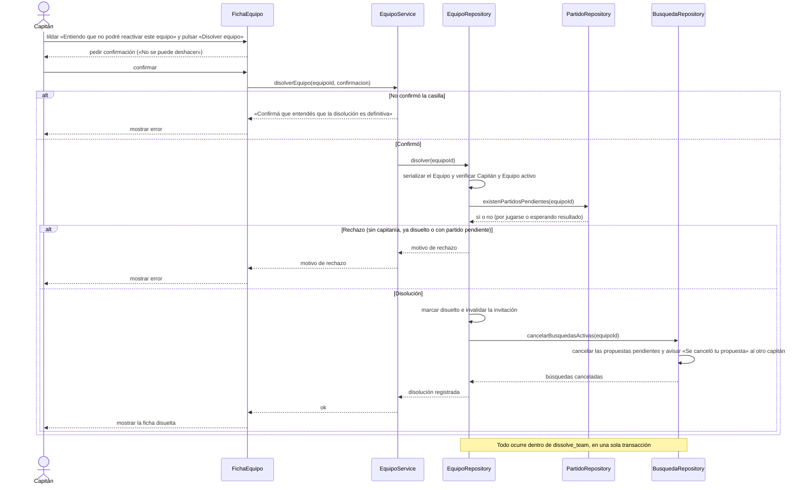

# S09 · UC-C09 — Disolver equipo

Caso de uso: [UC-C09](../02-casos-de-uso.md#uc-c09--disolver-equipo) · Pantalla: [P4](../03-pantallas.md#p4--equipo-vista-del-jugador-y-del-capitán) (sección «Disolver equipo») · Requerimientos: RF-C22 a RF-C25

No hay desplegables. La confirmación es una casilla y un cuadro de confirmación.

## Cómo se lee

- **Doble confirmación:** la casilla es obligatoria en el formulario y, además, el servidor vuelve a comprobarla; después el navegador pide una última confirmación («No se puede deshacer»).
- **Disolver no borra.** El Equipo queda marcado como disuelto: conserva su página, su Plantel, su escudo y su historia. **No se reactiva**: si vuelven, crean un Equipo nuevo.
- **Se bloquea con un partido sin terminar** (por jugarse o esperando resultado): «Tenés un partido pendiente: tiralo o cerrá el resultado antes de disolver». Así el rival no queda esperando una respuesta que nunca llega, y un Equipo acusado de no presentarse no puede escaparse disolviéndose.
- **Cancela las búsquedas de rival** como si el Capitán las cancelara una por una. Las propuestas pendientes (enviadas y recibidas) caen y el capitán del otro lado recibe el Aviso «Se canceló tu propuesta». La disolución no tiene motivo ni Aviso propios.
- **No toca la calificación:** los partidos Jugados se siguen pudiendo calificar hasta que venzan los 7 días.
- **Todo o nada:** las comprobaciones y los cambios van en una sola función de Postgres, así que un fallo a mitad de camino no deja un Equipo disuelto con búsquedas activas.

`PartidoRepository` y `BusquedaRepository` son responsabilidades de otro módulo (Partidos) que la disolución consulta; el módulo Equipos no las implementa.

## Correspondencia en el código

`dissolveTeam` (`src/app/equipos/[id]/actions.ts`) comprueba la casilla `confirm_dissolve` y llama a la RPC `dissolve_team` (versión de `20261028000006_matches.sql`, que agrega el bloqueo por partidos y la cancelación de búsquedas). Probado en `supabase/tests/teams_management_test.sql`.
