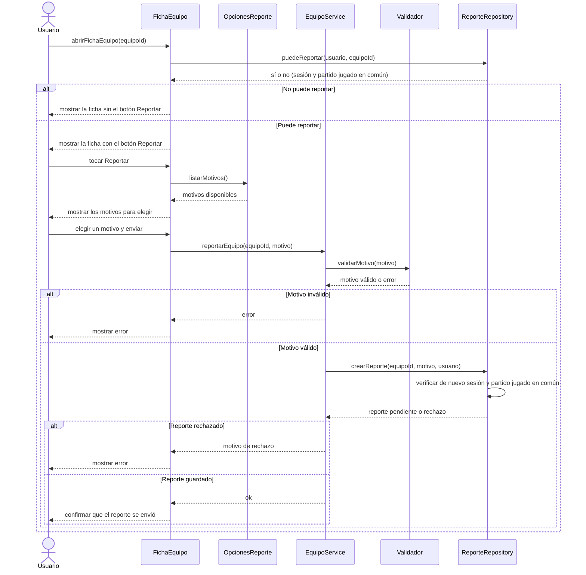

# S10 · UC-C10 — Reportar un equipo

Caso de uso: [UC-C10](../02-casos-de-uso.md#uc-c10--reportar-un-equipo) · Pantalla: [P3](../03-pantallas.md#p3--equipo-vista-pública) (botón «Reportar», todavía no existe) · Requerimientos: RF-C26

> **Diseño objetivo, pendiente de implementación.** Hoy no hay tabla, función ni pantalla de reportes de equipos. El diagrama dibuja lo que dicen las reglas vigentes; los participantes `OpcionesReporte` y `ReporteRepository` no existen todavía y sus nombres son provisorios.

El caso empieza con una elección entre tres motivos. Siguiendo la guía de formularios, la pantalla obtiene la lista de motivos **antes** de que la persona elija. Los motivos son una **lista fija del código** (no se guardan en la base), así que los provee un proveedor de opciones y no un repositorio.

## Cómo se lee

- **Quién ve el botón:** solo una persona con sesión que **jugó al menos un partido contra el Equipo reportado**. Que el botón aparezca no alcanza: `crearReporte` vuelve a verificarlo al guardar.
- **Motivos** (lista fija): «Violencia o agresiones», «Cuenta falsa» y «Abuso de calificaciones».
- **Destino:** el reporte queda pendiente para el administrador (UC-F04), que puede descartarlo o suspender al **Capitán**, porque el Capitán responde por la conducta del Plantel.
- **Sin decidir:** si una misma persona puede reportar más de una vez al mismo Equipo. En los torneos (UC-B06) es una sola vez por Usuario y torneo; para los Equipos no está definido. Hay que decidirlo antes de implementar y, entonces, agregar la regla a [decisiones-casos-de-uso.md](../../especificaciones-y-requerimientos/decisiones-casos-de-uso.md).
