# Módulo D · Equipos — especificación

Fuentes: `docs/casos-de-uso/casos-de-uso.pdf`, `docs/especificaciones-y-requerimientos/decisiones-casos-de-uso.md`, `CONTEXT.md`, código de `src/app` y migraciones de `supabase/migrations`. Cuando difieren, manda `docs/especificaciones-y-requerimientos/decisiones-casos-de-uso.md`. La columna «Estado» distingue las reglas vigentes de lo implementado en este checkout.

## 1. Alcance

El módulo permite consultar el catálogo público de Equipos, crear y gestionar un Equipo, formar su Plantel con un link de invitación, transferir la capitanía, editar los datos y disolver el Equipo. La página pública muestra los datos del Equipo y sus torneos con Inscripción vinculada; el Plantel solo lo ven sus integrantes. Al disolverse, conserva su página y su historia.

Búsqueda de rival y Partidos corresponden al módulo C; las Inscripciones, al E. La grilla de disponibilidad del PDF original fue eliminada. Las estadísticas y el historial de Partidos figuran como reglas vigentes, pendientes de esa integración.

## 2. Actores

| Actor | Descripción |
|---|---|
| Invitado | Persona sin sesión que consulta la página pública del Equipo. |
| Usuario | Persona con sesión; puede crear Equipos y aceptar invitaciones. |
| Jugador | Usuario que integra un Plantel; puede verlo y salir si no es Capitán. |
| Capitán | Jugador que gestiona un Equipo activo: edita, invita, saca integrantes, transfiere la capitanía y disuelve. |

Una persona tiene una sola cuenta. `Jugador` y `Capitán` son roles respecto de un Equipo, no cuentas distintas. Cada secuencia usa solo el actor que inicia su caso.

## 3. Casos de uso

### Diagrama de casos de uso

El mapa muestra qué actor inicia cada meta; el acceso público a la ficha y a su historial no vuelve público el Plantel.

| Referencia | Meta del actor | Estado de la implementación |
|---|---|---|
| UC-25 | Crear Equipo | Implementado; escudo opcional tras el alta transaccional |
| UC-26 | Pasar la capitanía | Implementado |
| UC-27 | Generar o regenerar invitación | Implementado |
| UC-28 | Aceptar invitación | Implementado; requiere pulsar «Unirme al equipo» |
| UC-29 | Consultar página pública del Equipo | Parcial: datos y torneos vinculados; estadísticas de Partidos pendientes |
| UC-30 | Consultar historial de Partidos | Pendiente del módulo de Partidos; caso distinto de UC-29 |
| Sin identificador canónico | Editar Equipo | Implementado |
| Sin identificador canónico | Salir del Equipo | Implementado |
| Sin identificador canónico | Sacar a un Jugador | Implementado; flujo distinto de Salir |
| Sin identificador canónico | Disolver Equipo | Parcial: disolución e invitación implementadas; integración con Partidos y Propuestas pendiente |

Los últimos cuatro flujos se describen por nombre hasta acordar identificadores en el inventario común. UC-32 del documento revisado juntaba «Sacar» y «Salir»; aquí se separan.

### UC-25 · Crear Equipo

Actor: Usuario con sesión. Precondiciones: WhatsApp cargado y menos de tres capitanías activas. Flujo: completa nombre, Zona, modalidad y nivel, con escudo opcional; el sistema valida, crea Equipo y Capitán en una transacción, intenta guardar el escudo y abre la ficha. Alternativas: sin sesión, datos inválidos, falta de WhatsApp, límite alcanzado o falla del escudo. Resultado: Equipo activo con creador como único integrante y Capitán.

### UC-26 · Pasar la capitanía

Actor: Capitán. Precondiciones: Equipo activo y destinatario integrante del Plantel, con WhatsApp y menos de tres capitanías. Flujo: elige al integrante y confirma; el sistema transfiere la capitanía y el anterior queda como Jugador. Alternativas: destinatario no elegible, Equipo disuelto o actor sin permiso. Resultado: un Capitán vigente.

### UC-27 · Generar o regenerar invitación

Actor: Capitán. Precondición: Equipo activo. Flujo: solicita un enlace, el sistema genera un token válido siete días y lo muestra para compartir. Alternativas: regenerar invalida el anterior; sin capitanía o con Equipo disuelto, se rechaza. Resultado: un solo enlace vigente por Equipo.

### UC-28 · Aceptar invitación

Actor: Usuario invitado. Flujo: abre `/unirse/{token}`, inicia sesión si hace falta, pulsa «Unirme al equipo» y llega a la ficha. Alternativas: enlace inexistente, vencido, reemplazado o de Equipo disuelto muestran el mismo mensaje; si ya integra el Plantel, llega al Equipo sin error. Resultado: integrante incorporado sin aprobación del Capitán.

### UC-29 · Consultar página pública del Equipo

Actor: Invitado o Usuario. Flujo: puede buscar un Equipo en `/equipos` por nombre, Zona, modalidad, nivel y estado; abre `/equipos/{id}` y ve escudo, nombre, Zona, corredor, modalidad, nivel, cantidad de jugadores y torneos vinculados. La marca de disolución se muestra cuando corresponde. Alternativa: Equipo inexistente, ficha no encontrada. El Plantel y los contactos quedan privados. Las estadísticas de Partidos se agregan con el módulo C.

### UC-30 · Consultar historial de Partidos

Actor: Invitado o Usuario. Flujo objetivo: abre el historial público del Equipo y ve presentismo, calificación y últimos cinco Partidos sin exponer cancha ni hora privadas. Estado: pendiente del módulo de Partidos; no se atribuye a vistas actuales de la base.

### Editar Equipo

Actor: Capitán. Flujo: cambia nombre, Zona, modalidad, nivel o escudo y guarda. Alternativas: datos inválidos, actor sin capitanía o Equipo disuelto; una falla al retirar el escudo anterior no deshace la edición. Resultado: ficha actualizada.

### Salir del Equipo

Actor: Jugador no capitán. Flujo: confirma la salida y se retira su pertenencia del Plantel. Alternativas: un Capitán debe transferir antes; un Equipo disuelto no admite salidas. Resultado: el Jugador deja de integrar el Equipo.

### Sacar a un Jugador

Actor: Capitán. Flujo: elige a otro integrante, confirma y el sistema lo retira del Plantel. Alternativas: no puede sacarse a sí mismo ni gestionar un Equipo disuelto. Resultado: Plantel actualizado.

### Disolver Equipo

Actor: Capitán. Flujo implementado: confirma la decisión, el sistema marca al Equipo como disuelto e invalida su invitación; la página, el Plantel, el escudo y la historia permanecen. Alternativas: falta de confirmación, actor sin capitanía o Equipo ya disuelto. Regla pendiente de integración: impedirlo con Partido acordado pendiente y cancelar Búsquedas de rival y Propuestas. Resultado: Equipo disuelto, sin reactivación.

### Reglas compartidas

- Crear requiere sesión y WhatsApp en el perfil. Una persona puede capitanear como máximo tres Equipos activos. El alta de Equipo y Capitán ocurre en una sola transacción.
- Zona proviene de una lista cerrada. La clave foránea `teams.zone_id → zones.id` valida su existencia al guardar; no hay una consulta separada `existeZona` en el alta.
- La invitación vale siete días; regenerarla invalida la anterior. Abrir el enlace muestra la pantalla, y pulsar «Unirme al equipo» incorpora al Plantel. No se pide aprobación al Capitán. La pulsación evita que las vistas previas de chats incorporen personas.
- Un Equipo disuelto conserva página, Plantel, escudo e historia y no se reactiva. Hoy se invalida su invitación y se impide gestionarlo. Bloquear la disolución por Partidos pendientes y cancelar Búsquedas de rival y Propuestas es una regla vigente cuya integración está pendiente.
- Plantel y contactos son privados. La ficha pública muestra datos básicos y torneos con Inscripción vinculada. Presentismo, calificación e historial de Partidos se incorporan con el módulo de Partidos.

## 4. Diagramas de secuencia

Los diagramas recuperan los objetos del primer PDF y usan solo los que intervienen en cada caso. Los nombres `EquipoService` y `EquipoRepository` expresan responsabilidades conceptuales: en el código actual corresponden a Server Actions, utilidades de acceso a datos y funciones de Postgres, no a dos clases TypeScript ya implementadas. Cada caso tiene un solo actor iniciador; `Capitán` y `Jugador` son roles de una misma cuenta.

| Participante | Responsabilidad | Correspondencia en el repositorio |
|---|---|---|
| Usuario, Jugador, Capitán o Invitado | Persona que inicia el caso. | Sesión y relación con el Equipo; Invitado navega sin sesión. |
| FormularioCrearEquipo | Mostrar el alta, cargar sus listas y enviar los datos. | `TeamForm` y `ZoneSelect` en `/crear-equipo`. |
| OpcionesEquipo | Proveer modalidad y nivel para los selectores. | Listas fijas `SPORT_MODALITIES` y `TEAM_LEVELS`; no consulta a la base. |
| EquipoService | Coordinar el caso de uso y su respuesta. | Server Actions de `crear-equipo`, `equipos/[id]` y `unirse/[token]`; lectura de páginas. |
| Validador | Validar entradas antes de escribir. | `parseTeamForm` y `parseCrest`. |
| Equipo | Estado y datos de la entidad de dominio. | `teams` y `team_members`; no es una clase TypeScript instanciada por la app. |
| EquipoRepository | Leer y escribir el Equipo, Plantel e invitaciones. | Consultas y funciones de Postgres; `saveTeam` para datos y escudo. |
| Localidad | Referencia geográfica del Equipo. | La **Zona** de `zones`, con Corredor y Región; `teams.zone_id` la referencia. |

`Localidad` se conserva como nombre del objeto del primer PDF; en el dominio y la UI se dice **Zona**. Su existencia se garantiza por clave foránea al guardar, sin una llamada independiente `existeZona`.

### S01 — UC-25 Crear Equipo

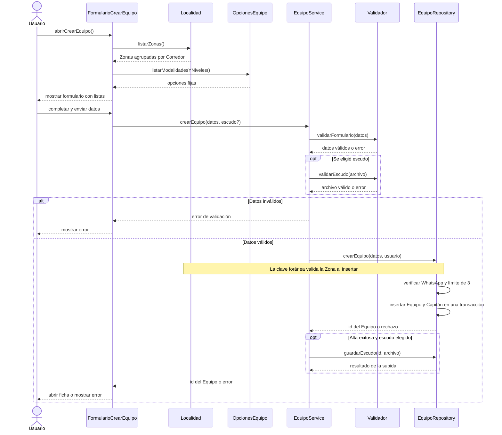

La Zona se valida mediante la clave foránea al insertar. Si falla el escudo, el Equipo ya existe y se abre Editar para reintentar.

### S02 — UC-26 Pasar la capitanía

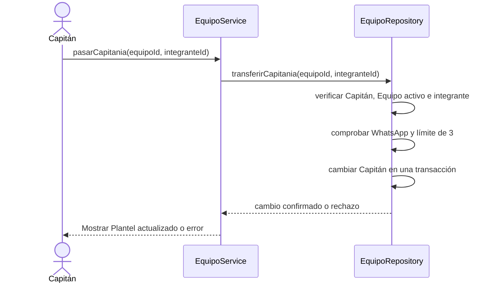

### S03 — UC-27 Generar o regenerar invitación

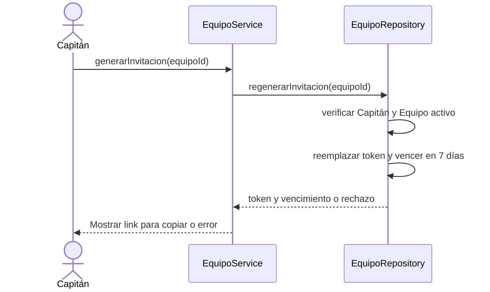

### S04 — UC-28 Aceptar invitación

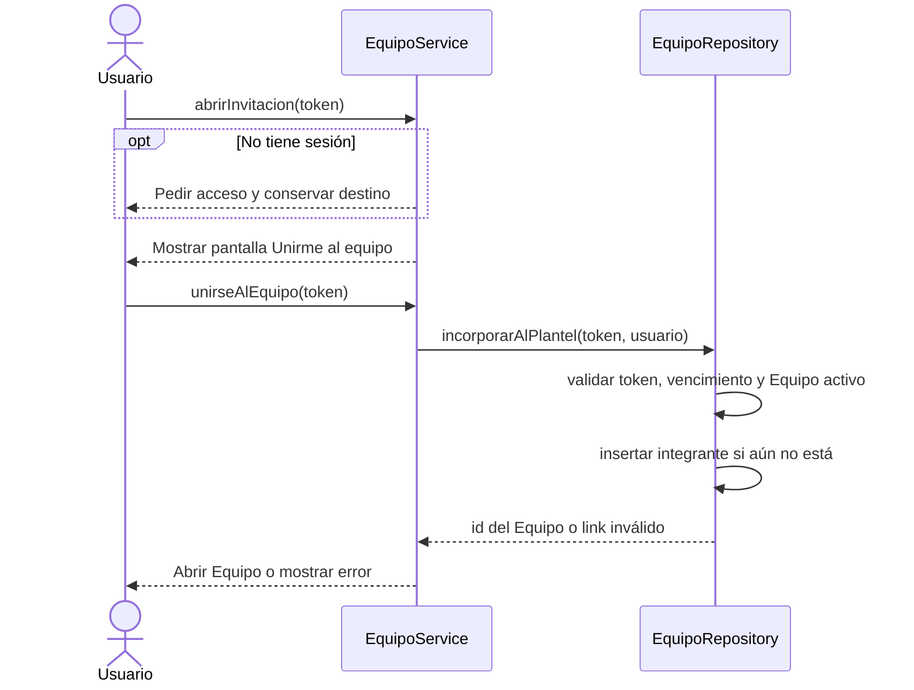

El Capitán no interviene al aceptar. Un integrante existente llega al Equipo sin error.

### S05 — UC-29 Consultar página pública del Equipo

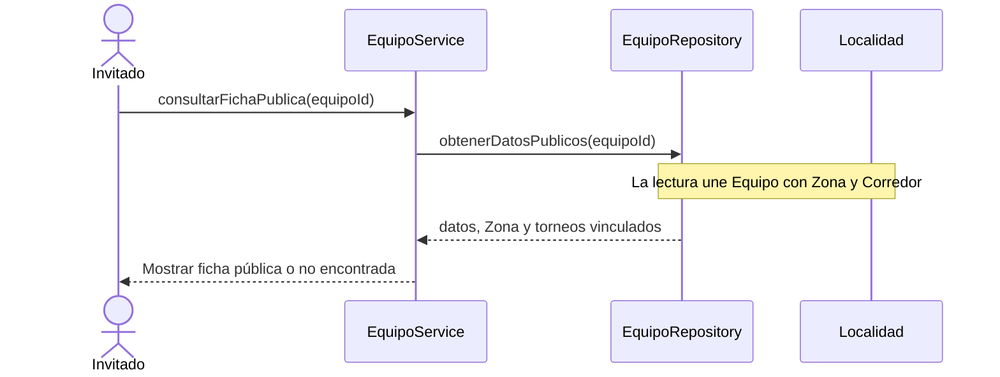

El Plantel se consulta aparte solo para integrantes. La ficha aún no muestra estadísticas de Partidos.

### S06 — UC-30 Consultar historial de Partidos (pendiente)

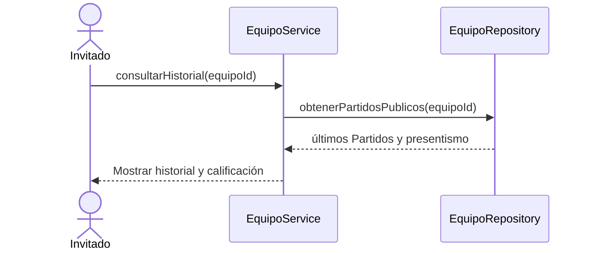

Flujo objetivo; las vistas y tablas de Partidos todavía no están en este checkout.

### S07 — Editar Equipo

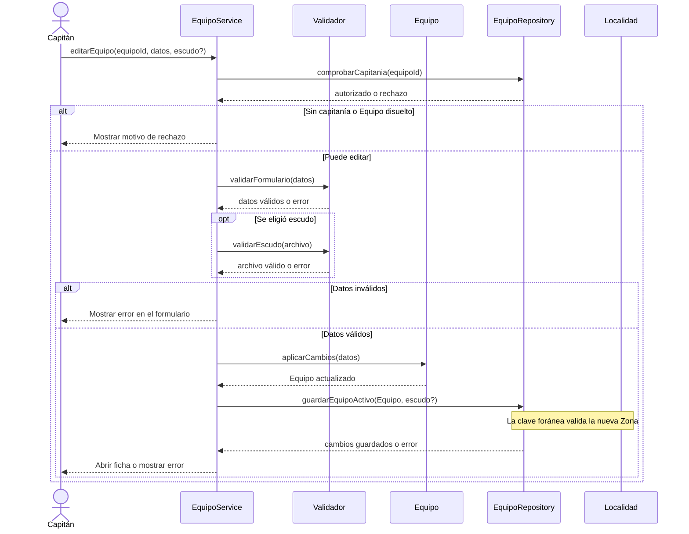

### S08 — Salir del Equipo

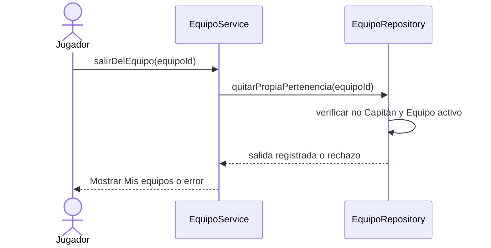

### S09 — Sacar a un Jugador

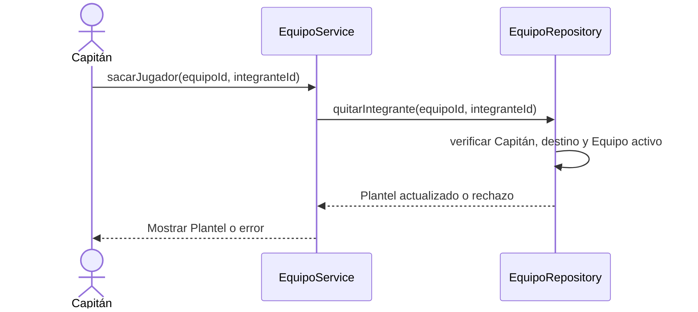

### S10 — Disolver Equipo

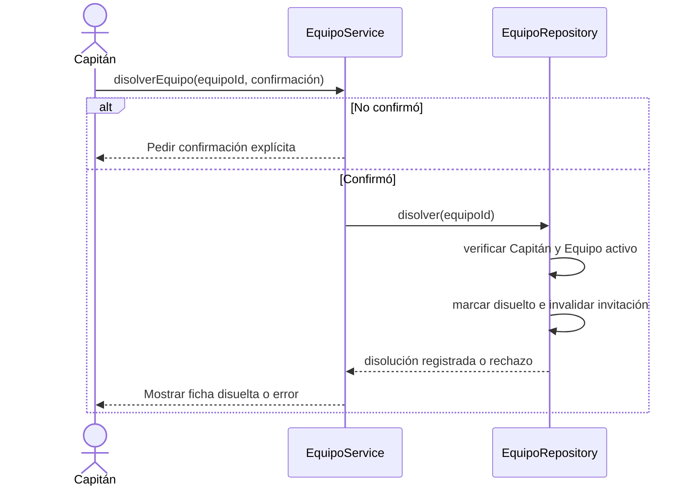

El bloqueo por Partido pendiente y la cancelación de Búsquedas de rival y Propuestas **no** se representan como ejecución actual: se agregan cuando exista el módulo de Partidos.

## 5. Especificación de requerimientos

Los requerimientos expresan el producto acordado. La columna «Estado» indica qué parte se comprueba en el checkout actual; no modifica la vigencia de una regla.

### 5.1 · Requerimientos funcionales

| ID | Requerimiento | Estado |
|---|---|---|
| RF-D01 | Crear Equipo con nombre, Zona, modalidad y nivel válidos. | Implementado |
| RF-D02 | Escudo opcional JPG, PNG o WebP de hasta 2 MB; subir, reemplazar o quitar. | Implementado |
| RF-D03 | Permitir nombres de Equipo repetidos; distinguirlos por Zona. | Implementado |
| RF-D04 | Exigir sesión y WhatsApp en el perfil para crear Equipo. | Implementado |
| RF-D05 | Máximo tres capitanías de Equipos activos por persona, también al transferir. | Implementado |
| RF-D06 | Crear Equipo y Capitán inicial en una transacción. | Implementado |
| RF-D07 | Link de invitación de siete días; regenerar invalida el anterior. | Implementado |
| RF-D08 | Unirse al Plantel al pulsar el botón, sin aprobación; si ya pertenece, abrir Equipo. | Implementado |
| RF-D09 | Mensaje único para link inexistente, vencido, regenerado o de Equipo disuelto. | Implementado |
| RF-D10 | Conservar destino de invitación al iniciar sesión. | Implementado |
| RF-D11 | Pasar la capitanía a integrante con WhatsApp y menos de tres capitanías. | Implementado |
| RF-D12 | Impedir que el Capitán salga o se saque sin transferir la capitanía. | Implementado |
| RF-D13 | Permitir Salir a Jugador no capitán y Sacar a otro integrante al Capitán. | Implementado; dos casos distintos |
| RF-D14 | Solo el Capitán edita un Equipo activo. | Implementado |
| RF-D15 | Disolver con confirmación, sin borrar Equipo, página, Plantel ni historia. | Implementado |
| RF-D16 | Impedir disolución si hay Partido acordado pendiente. | Pendiente del módulo de Partidos |
| RF-D17 | Al disolver, invalidar invitación y cancelar Búsquedas y Propuestas pendientes. | Invitación implementada; resto pendiente |
| RF-D18 | Equipo disuelto sin nuevas incorporaciones, ediciones, salidas o expulsiones. | Implementado para gestión actual |
| RF-D19 | Ficha pública con datos, torneos vinculados, presentismo, calificación e historial. | Datos y torneos implementados; Partidos pendiente |
| RF-D20 | Plantel visible solo para sus integrantes. | Implementado |
| RF-D21 | Mis equipos lista activos primero, disueltos después y marca capitanía. | Implementado |
| RF-D22 | Cambiar Capitán o Plantel sin bloquear por Partido en curso; el nuevo Capitán opera lo pendiente. | Regla vigente; integración pendiente |
| RF-D23 | Catálogo público de Equipos con búsqueda por nombre y filtros por Zona, modalidad, nivel y estado; enlace a cada ficha. | Implementado |

### 5.2 · Requerimientos no funcionales

| ID | Requisito | Evidencia o límite |
|---|---|---|
| RNF-D01 | Control de acceso en la base. | RLS para Equipos y Plantel; funciones para cambios de integrantes. |
| RNF-D02 | Un Capitán por Equipo activo. | Índice único parcial impide duplicados; funciones de cambio conservan el Capitán. |
| RNF-D03 | Límite de capitanías aun con altas simultáneas. | `create_team` y transferencia bloquean el perfil antes de contar. |
| RNF-D04 | Privacidad del Plantel y contactos. | Plantel con RLS; WhatsApp fuera de la ficha pública. |
| RNF-D05 | Token no adivinable ni listable. | 16 bytes aleatorios codificados en hex; tabla sin lectura directa. |
| RNF-D06 | Alta atómica. | `create_team` inserta Equipo y Capitán en una transacción. |
| RNF-D07 | Errores claros y confirmación de acciones destructivas. | Mensajes en UI; confirmar Salir, Sacar, transferir y disolver. |
| RNF-D08 | URL pública estable por Equipo. | `/equipos/{id}` accesible sin sesión. |
| RNF-D09 | Validación pura y verificable. | `parseTeamForm`, `parseCrest` y pruebas de base. |

## 6. Reflejo en la página

Las rutas siguientes muestran qué puede hacer la persona y qué todavía espera al módulo de Partidos. Los cambios de Plantel se ejecutan mediante funciones de base, no por edición directa desde la UI.

### 6.1 · Pantallas y rutas

| Ruta | Caso | Estado visible |
|---|---|---|
| `/equipos` | UC-29 (acceso a la ficha) | Catálogo público con filtros y tarjetas de Equipos. |
| `/mis-equipos` | UC-25 y gestión del Plantel | Lista de Equipos y acceso al alta. |
| `/crear-equipo` | UC-25 | Formulario y errores de alta. |
| `/equipos/{id}` | UC-29 | Datos y torneos vinculados públicos; Plantel solo a integrantes. |
| `/equipos/{id}` — Partidos | UC-30 | Presentismo, calificación y últimos Partidos pendientes. |
| `/equipos/{id}` — invitación | UC-27 | Generar, ver y regenerar link como Capitán. |
| `/equipos/{id}` — Plantel | UC-26; Salir; Sacar | Acciones según el rol de la persona. |
| `/equipos/{id}` — disolución | Disolver | Confirmación y estado disuelto; integración con Partidos pendiente. |
| `/equipos/{id}/editar` | Editar | Datos y escudo para Capitán de Equipo activo. |
| `/unirse/{token}` | UC-28 | Pantalla y botón «Unirme al equipo». |
| `/perfil` | UC-25 y UC-26 | WhatsApp requerido para crear o recibir capitanía. |

#### Pantalla: Crear equipo

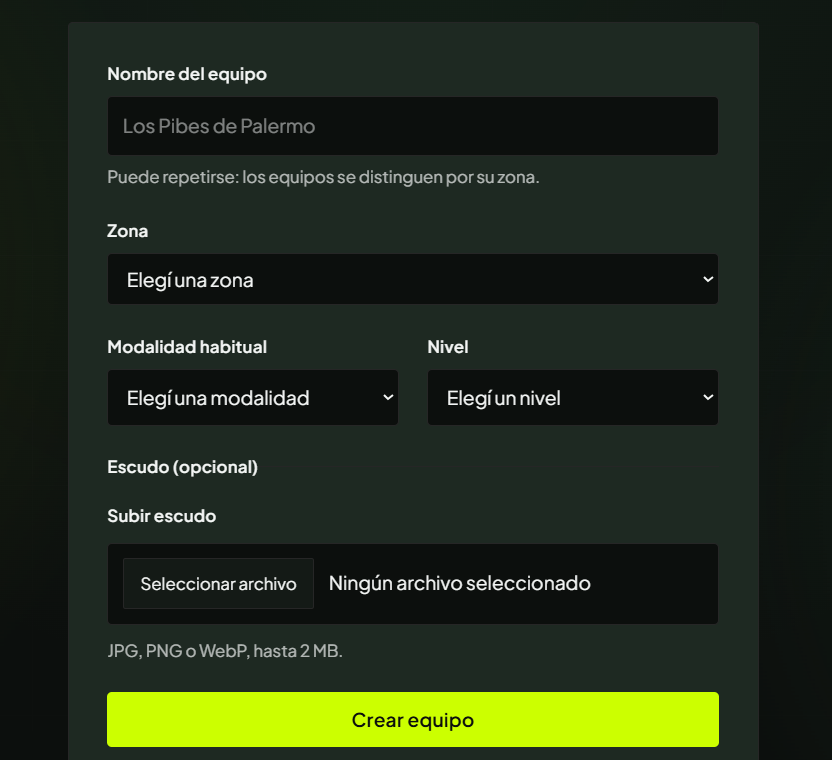

Esta pantalla corresponde a **UC-25 · Crear Equipo**. La persona ingresa nombre, Zona, modalidad habitual y nivel; puede adjuntar un escudo y confirma con «Crear equipo». El aviso de que el nombre puede repetirse expresa RF-D03. La selección de Zona representa la referencia geográfica; el control de sesión, WhatsApp y límite de capitanías se completa al guardar. La captura muestra el formulario, no la totalidad de las validaciones ni el resultado del alta.

#### Pantalla: Mis equipos

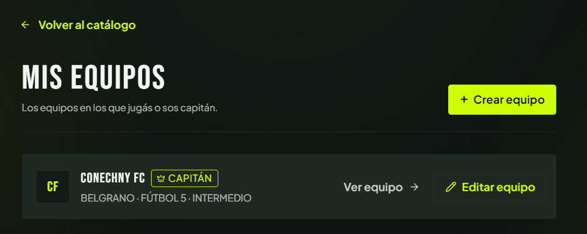

La lista muestra los Equipos que integra la persona, su rol de Capitán cuando corresponde y las acciones para abrir la ficha, editar o crear un Equipo. La captura muestra un Equipo activo y no ejemplifica el estado Disuelto.

#### Pantalla: Ficha del Equipo vista por el Capitán

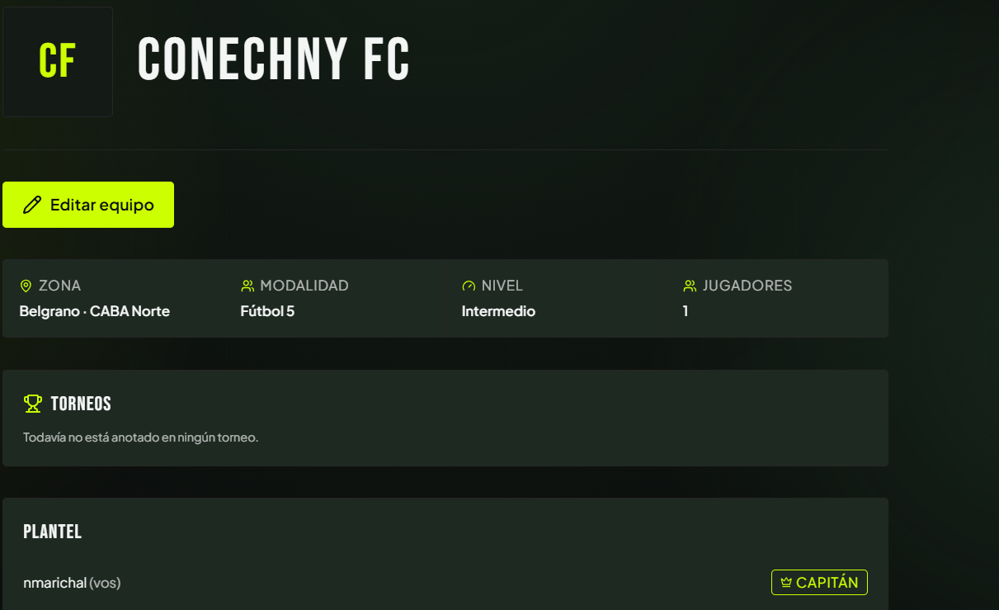

La ficha reúne identidad, Zona, modalidad, nivel, cantidad de jugadores, torneos vinculados y Plantel. En esta captura aparece «Editar equipo» y el Plantel porque la persona es Capitán. Esas partes privadas no deben confundirse con la vista de un Invitado.

#### Pantalla: Gestión del Capitán

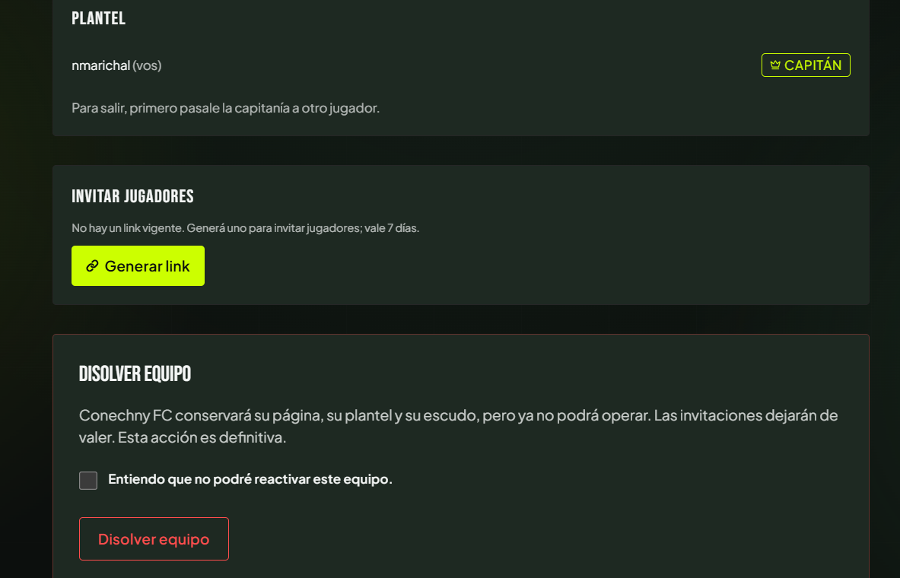

La captura muestra el Plantel con el Capitán como único integrante, la opción de generar invitación y la confirmación para disolver. Para salir, el Capitán debe pasar antes la capitanía. Cuando haya otros integrantes, cada uno tendrá acciones de pasar capitanía o Sacar, según corresponda.

#### Pantalla: Invitación vigente

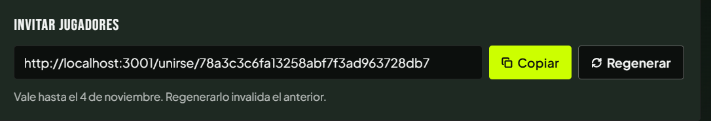

Después de generarlo, el Capitán puede copiar o regenerar el link y ve su fecha de vencimiento. Regenerar invalida el anterior. El token mostrado en la captura es un ejemplo local; la especificación no depende de su valor.

| Estado | Acción del Capitán | Resultado |
|---|---|---|
| Sin link vigente | Generar link | Se obtiene un enlace válido por siete días. |
| Link vigente | Copiar | Se comparte el mismo enlace sin cambiar su vencimiento. |
| Link vigente | Regenerar | Se crea otro enlace y el anterior deja de valer. |

#### Otras pantallas y estados

| Pantalla o estado | Qué debe mostrar | Casos |
|---|---|---|
| Catálogo público de Equipos | Búsqueda y filtros; tarjetas con estado y enlace a ficha. | Acceso a UC-29 |
| Mis equipos | Equipos propios, marca de Capitán o Disuelto y acceso a Crear equipo. | UC-25; navegación de gestión |
| Ficha pública | Identidad del Equipo, datos, cantidad de jugadores, torneos vinculados y estado. Sin Plantel ni contactos públicos. | UC-29 |
| Ficha para integrante | Plantel privado y acción Salir para Jugador no capitán. | Salir del Equipo |
| Ficha para Capitán | Acciones de pasar capitanía, sacar integrante, generar o regenerar link y disolver. | UC-26; UC-27; Sacar; Disolver |
| Editar equipo | Formulario con valores actuales y escudo; acción Guardar cambios. | Editar Equipo |
| Invitación recibida | Explicación y botón «Unirme al equipo»; error genérico para link inválido. | UC-28 |
| Mi perfil | Campo WhatsApp y regreso a Crear equipo cuando falta el dato. | Precondición de UC-25 y UC-26 |
| Equipo disuelto | Marca pública de disolución y conservación de su ficha; gestión deshabilitada. | Disolver Equipo; UC-29 |
| Historial de Partidos | Presentismo, calificación y últimos cinco Partidos públicos, sin datos privados del encuentro. | UC-30; pendiente del módulo C |

Las capturas muestran los estados disponibles aportados para esta revisión. Las acciones Pasar la capitanía, Aceptar invitación, Editar, Salir y Sacar están ubicadas en sus pantallas y rutas, aunque no se adjuntó una captura de cada estado. UC-30 todavía no tiene pantalla implementada.

### 6.2 · Trazabilidad con la base

| Función o política | Migración | Cobertura |
|---|---|---|
| `create_team` y lectura de Equipo | `20260928000004_teams.sql` | RF-D01, D04 a D06 y D23 |
| `regenerate_team_invite` y `join_team` | `20260929000002_team_invites.sql` y `20261014000003_team_management_locks.sql` | RF-D07 a D10 |
| `transfer_captaincy`, `leave_team`, `remove_team_member` | `20260929000003_team_roster_changes.sql` y `20261014000003_team_management_locks.sql` | RF-D11 a D13 |
| Edición de Equipo activo y Plantel privado | `20260928000004_teams.sql` | RF-D14, D20 |
| `dissolve_team` | `20261014000001_team_dissolve.sql` | RF-D15; parte de D17 y D18 |
| `team_crests` | `20261014000002_team_crests.sql` | RF-D02 |
| Partidos, Propuestas e historial | Pendiente en este checkout | RF-D16, resto de D17, parte de D19 y D22 |

## 7. PDF vs. implementación

| Tema | Documento original | Vigente o implementado |
|---|---|---|
| Disponibilidad | SPEC-D02 incluye grilla de días y franjas. | Eliminada; no existe en la página ni en la base. |
| Historial (UC-30) | Solo para miembros. | Visibilidad pública acordada; estadísticas y últimos Partidos pendientes de implementación. |
| Crear Equipo | Sesión y límite de capitanías. | También exige WhatsApp; Equipo y Capitán se insertan en una transacción. |
| Invitación inválida | Mensaje de pedir otro link al Capitán. | Mensaje único: «El link de invitación no es válido o venció». |
| Aceptar invitación | Entrada directa. | Requiere pulsar «Unirme al equipo»; no requiere aprobación del Capitán. |
| Editar, salir, sacar, disolver | Sin caso numerado en el PDF de la materia. | Reglas definidas en decisiones; se describen por nombre sin adoptar nuevos números UC. |
| Disolver con Partidos pendientes | Regla del producto. | La disolución actual no implementa aún el bloqueo por Partidos ni la cancelación de Propuestas. |
| Usuario suspendido | Sin tratamiento. | Puede sumarse al Plantel, pero no recibir capitanía; el control espera la integración de Suspensión. |
| Catálogo público | No figura entre las pantallas del documento original. | `/equipos` permite buscar y filtrar Equipos antes de abrir su ficha pública. |

Fuentes del repo: `CONTEXT.md`, `docs/especificaciones-y-requerimientos/decisiones-casos-de-uso.md`, `docs/especificaciones-y-requerimientos/mejoras-equipos-ux.md`, `src/app/crear-equipo/actions.ts`, `src/app/unirse/[token]/page.tsx`, `src/app/equipos/[id]/page.tsx` y las migraciones indicadas arriba.
