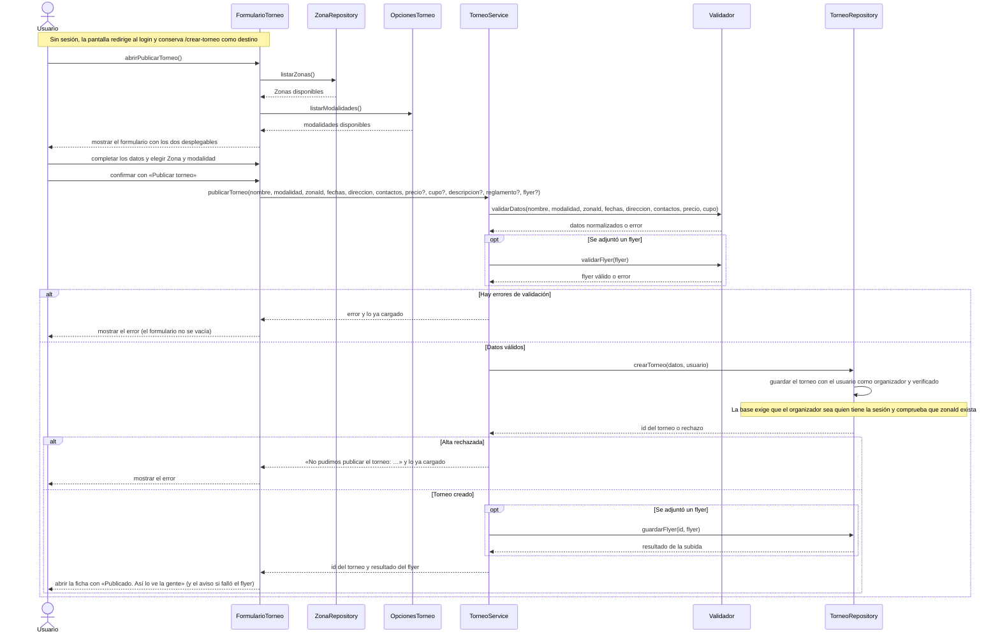

# S01 · UC-E01 — Publicar un torneo

Caso de uso: [UC-E01](../02-casos-de-uso.md#uc-e01--publicar-un-torneo) · Pantalla: [P2](../03-pantallas.md#p2--publicar-torneo) · Requerimientos: RF-E01 a RF-E08

El formulario tiene **dos desplegables**: la **Zona** y la **modalidad**. Siguiendo la guía de formularios, la pantalla obtiene las opciones de cada uno **antes** de que la persona elija: las Zonas, que se consultan en la base, de `ZonaRepository`; las modalidades, que son una lista fija del código, de `OpcionesTorneo`. Al enviar viajan solo los valores elegidos (`zonaId`, `modalidad`). La carga de las opciones y la publicación van en el mismo diagrama.

## Cómo se lee

- **Antes de elegir:** la pantalla obtiene las Zonas de `ZonaRepository` y las modalidades de `OpcionesTorneo`, y recién entonces muestra el formulario. Al enviar viajan solo los **valores elegidos**.
- **El organizador sale de la sesión, nunca del formulario.** `crearTorneo(datos, usuario)` recibe el usuario de la sesión, y la base lo exige otra vez (`auth.uid() = user_id`). Cualquier campo de más que mande el cliente no se guarda: el organizador solo puede escribir las columnas del formulario.
- **Se valida de nuevo al guardar.** `Validador` revisa nombre, modalidad, Zona, fechas (**cierre ≤ inicio ≤ fin**), dirección, contactos (al menos uno), precio y cupo aunque el formulario tenga sus restricciones; y la base comprueba que la Zona exista.
- **El torneo nace verificado** y se muestra en el catálogo con su Estado calculado.
- **El flyer se sube después del alta**, no dentro de ella: el archivo se llama como el id del torneo, que antes no existe, y así un alta que falla no deja un archivo huérfano. Si lo que falla es la subida, el torneo **ya está publicado**: la ficha avisa «No pudimos subir el flyer» y se reintenta desde la pestaña Datos.
- **Suspensión (pendiente):** un usuario suspendido no puede publicar. Todavía no se verifica porque la Suspensión no está implementada (UC-F05).
- **Si el formulario falla, no se vacía:** devuelve el error y lo ya cargado (salvo el archivo, que un navegador no deja precargar).

## Correspondencia en el código

`createTournament` (`src/app/crear-torneo/actions.ts`): `parseTournamentForm` → `parseFlyer` → `insert` en `tournaments` con `user_id` de la sesión → `uploadFlyer` → redirige a `/torneos/{id}?publicado=1`. Las Zonas salen de `zones` mediante `getZoneGroups()`; las modalidades, de `SPORT_MODALITIES`.
