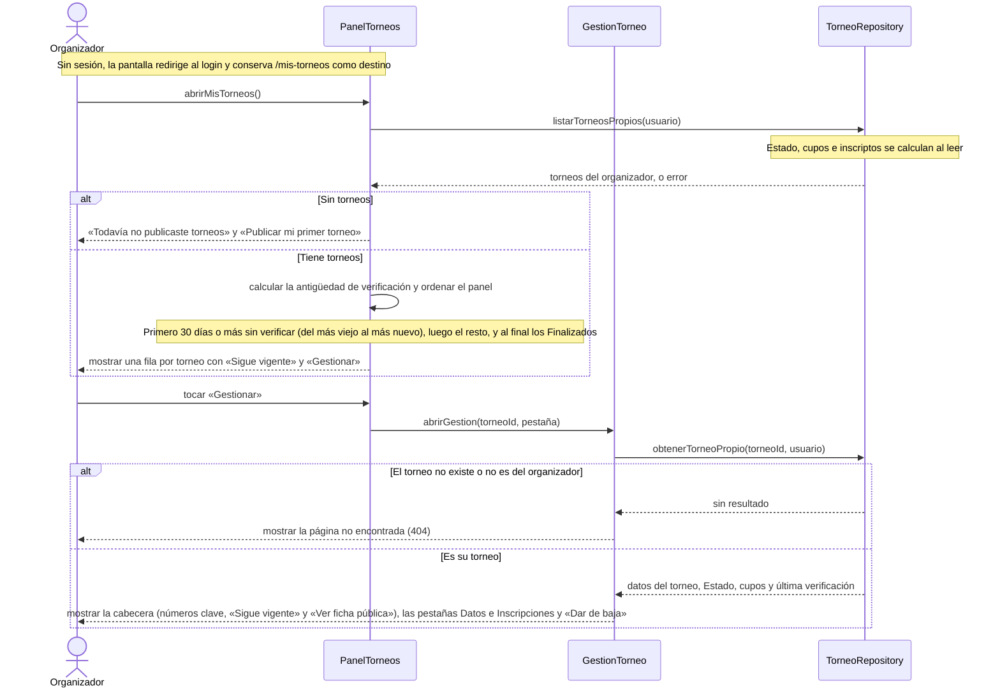

# S02 · UC-E02 — Ver mis torneos (Panel de organizador)

Caso de uso: [UC-E02](../02-casos-de-uso.md#uc-e02--ver-mis-torneos-panel-de-organizador) · Pantallas: [P1](../03-pantallas.md#p1--mis-torneos) y [P3](../03-pantallas.md#p3--gestión-del-torneo) · Requerimientos: RF-E12 a RF-E15

Es una consulta: no hay formulario ni desplegables.

## Cómo se lee

- **Una fila por torneo** con nombre, Zona, modalidad, cupo, Estado y antigüedad, y solo dos acciones: «Sigue vigente» y «Gestionar». Editar, inscripciones y baja viven **solo en la pantalla de gestión**.
- **El orden pone primero lo que pide atención:** los torneos con 30 días o más sin verificar, del más viejo al más nuevo. Los **Finalizados** van al final, sin antigüedad ni botón de verificar.
- **Un torneo ajeno da 404, igual que uno inexistente:** no se confirma que exista un torneo con ese id que no es tuyo. Un id que no es un uuid hace fallar la consulta y cae en el mismo 404.
- **Tres niveles:** la lista, la gestión y la ficha pública (que, para el dueño, agrega la barra «Este torneo es tuyo · Gestionar»).
- La pestaña vive en `?tab=` (Datos o Inscripciones): cada una tiene su URL, y cualquier valor desconocido abre Datos.

## Correspondencia en el código

`MisTorneosPage` (`src/app/mis-torneos/page.tsx`) lee los torneos del usuario y usa `sortForPanel`; `GestionTorneoPage` (`src/app/mis-torneos/[id]/page.tsx`) filtra por `id` y `user_id` y llama a `notFound()` si no hay resultado.
