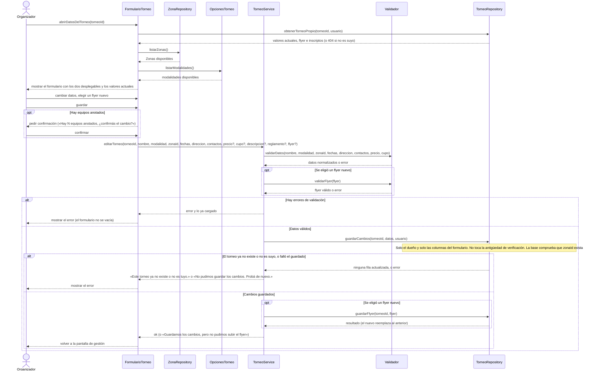

# S03 · UC-E03 — Editar un torneo

Caso de uso: [UC-E03](../02-casos-de-uso.md#uc-e03--editar-un-torneo) · Pantalla: [P3](../03-pantallas.md#p3--gestión-del-torneo) (pestaña Datos) · Requerimientos: RF-E02 a RF-E06, RF-E09 a RF-E11

Es el mismo formulario que [S01](uc-e01-publicar-torneo.md), con los dos desplegables (**Zona** y **modalidad**): sigue el mismo criterio. La carga de las opciones y el guardado van en el mismo diagrama. La diferencia: el formulario llega con los **valores actuales**, se **confirma** si hay equipos anotados y la base solo deja editar al dueño.

## Cómo se lee

- **Mismo patrón que publicar:** las Zonas de `ZonaRepository`, las modalidades de `OpcionesTorneo`, y al enviar solo los **valores elegidos**. Los valores actuales vienen de `obtenerTorneoPropio`; el WhatsApp se muestra como lo cargó la persona (sin el `549`).
- **Quién puede editar lo decide la base**, no el código: la policy de actualización exige ser el dueño y los permisos por columna dejan escribir solo las del formulario. Con un torneo ajeno o dado de baja la actualización **no da error: afecta cero filas**, y por eso el mensaje «Este torneo ya no existe o no es tuyo».
- **Se valida de nuevo al guardar**, con las mismas reglas del alta.
- **Editar no cuenta como verificar:** `verified_at` no se toca (la persona no puede escribirlo, solo `verify_tournament`). Reiniciar la antigüedad es «Sigue vigente» ([S04](uc-e04-verificar-torneo.md)).
- **Confirmación con equipos anotados:** si hay inscriptos, el cambio los afecta (fechas, cupo, sede), así que se pide confirmar. Sin equipos, no se pregunta.
- **Subir el cupo** es la forma de admitir más inscripciones cuando está completo.
- **El flyer:** dejarlo vacío conserva el actual; uno nuevo **reemplaza** al anterior (mismo objeto). Si la subida falla, los cambios ya están guardados y se avisa.

## Correspondencia en el código

`updateTournament` (`src/app/mis-torneos/[id]/editar/actions.ts`): `parseTournamentForm` → `parseFlyer` → `update` filtrado por `id` y `user_id` → `uploadFlyer` → redirige a `/mis-torneos/{id}?tab=datos`. La confirmación sale de `editConfirmation` (`utils/tournament-form.ts`).
