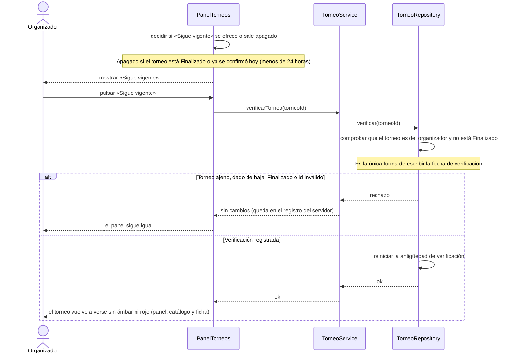

# S04 · UC-E04 — Verificar que el torneo sigue vigente

Caso de uso: [UC-E04](../02-casos-de-uso.md#uc-e04--verificar-que-el-torneo-sigue-vigente) · Pantallas: [P1](../03-pantallas.md#p1--mis-torneos) y [P3](../03-pantallas.md#p3--gestión-del-torneo) (botón «Sigue vigente») · Requerimientos: RF-E16 a RF-E18

No hay desplegables ni datos que cargar: es un solo botón, que es un formulario con el id del torneo en un campo oculto (funciona sin JavaScript).

## Cómo se lee

- **Qué hace:** reinicia la **antigüedad de verificación** (días completos desde la última confirmación). A los 30 días el torneo se ve en ámbar y a los 60 en rojo con «Sin confirmar»; «Sigue vigente» lo devuelve a «Verificado hoy».
- **El botón se apaga en dos casos:** un torneo **Finalizado** (ya no tiene que confirmar que sigue en pie) y uno **ya confirmado hoy** (la regla del código; no figura en `casos-de-uso.md`).
- **Solo la función de la base escribe la fecha.** El organizador no puede actualizar `verified_at` directamente ni con una edición: por eso **editar no cuenta como verificar**.
- **Si la base rechaza, no se muestra error:** solo puede pasar con un torneo ajeno, dado de baja, Finalizado o un id inventado, y el panel nunca le ofrece esos casos al dueño. Alcanza con el registro del servidor.
- **No saca la marca Observado** (que pone el administrador por reportes y solo él saca); la marca todavía no existe.

## Correspondencia en el código

`verifyTournament` (`src/app/mis-torneos/actions.ts`) llama a la RPC `verify_tournament`; `VerifyButton` decide si el botón sale apagado con `verifyBlock` (`utils/tournament-verification.ts`).
