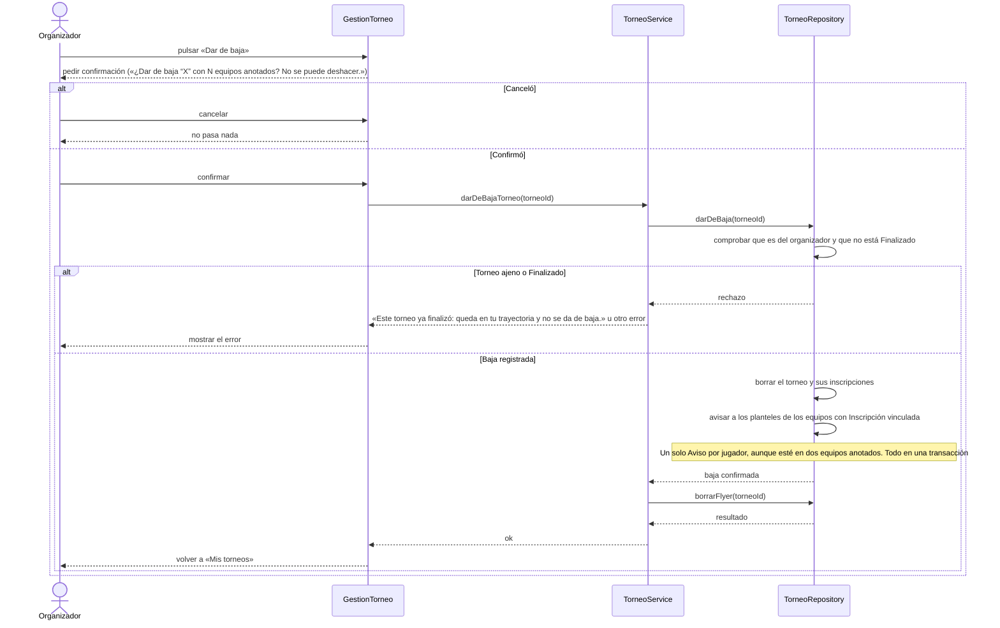

# S05 · UC-E05 — Dar de baja un torneo

Caso de uso: [UC-E05](../02-casos-de-uso.md#uc-e05--dar-de-baja-un-torneo) · Pantalla: [P3](../03-pantallas.md#p3--gestión-del-torneo) («Dar de baja», al final) · Requerimientos: RF-E19 a RF-E22

No hay desplegables. La baja siempre pide una confirmación con el nombre y la cantidad de equipos anotados.

## Cómo se lee

- **Confirmación siempre**, haya o no equipos anotados: la baja no tiene vuelta atrás. A diferencia de editar, que solo confirma si hay inscriptos.
- **Nunca un Finalizado:** los torneos finalizados son la trayectoria del organizador y se ven en su página pública. Aunque el botón no se ofrezca, el Estado puede cambiar entre que se carga la página y se pulsa (por ejemplo, el torneo termina a medianoche): la base lo vuelve a comprobar y el mensaje se muestra.
- **Qué desaparece:** el torneo sale del catálogo, su ficha devuelve 404 y se borra el flyer de Storage.
- **El flyer se borra después de la baja.** Postgres no puede borrar archivos, así que se hace por la API de Storage una vez que la base confirmó. Así, un torneo que no pudo darse de baja no se queda sin flyer.
- **Aviso a los planteles:** cada jugador del Plantel (el del momento de la baja) de cada equipo con **Inscripción vinculada** recibe **un único Aviso**, con link a la página del equipo, porque la ficha ya devuelve 404: «Se dio de baja el torneo 'X', en el que estaba anotado tu equipo. Hablá con el organizador por lo que hayas pagado.» Las inscripciones por nombre no tienen plantel al que avisar.
- **Quién más puede:** el administrador, por un reporte (UC-F03), con las mismas consecuencias.

## Correspondencia en el código

`withdrawTournament` (`src/app/mis-torneos/actions.ts`) llama a la RPC `withdraw_tournament` (versión de `20261028000016_withdraw_tournament_one_notice.sql`) y después a `removeFlyer`; `WithdrawButton` pide la confirmación con `withdrawConfirmation` (`utils/tournament-withdraw.ts`). Probado en `supabase/tests/tournaments_withdraw_test.sql`.
