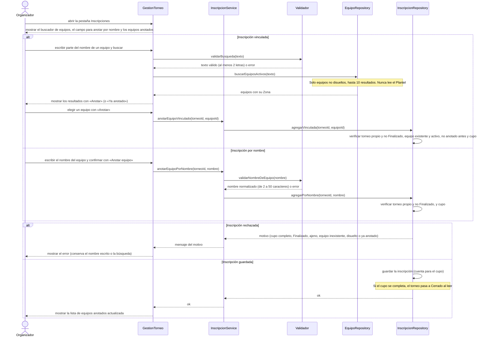

# S06 · UC-E06 — Cargar una inscripción

Caso de uso: [UC-E06](../02-casos-de-uso.md#uc-e06--cargar-una-inscripción) · Pantalla: [P3](../03-pantallas.md#p3--gestión-del-torneo) (pestaña Inscripciones) · Requerimientos: RF-E23 a RF-E30

No hay desplegables: el equipo vinculado se elige de **resultados de una búsqueda por nombre** (un campo de texto), no de una lista fija. Los resultados salen de la base, así que los provee `EquipoRepository`. Los dos tipos de inscripción son **un solo caso de uso** y van en el mismo diagrama.

## Cómo se lee

- **La inscripción ya se arregló afuera.** El capitán le escribió al organizador por WhatsApp o Instagram (UC-B04); acá el organizador solo **registra** lo acordado. El capitán **no confirma** la vinculación y el organizador **no ve el WhatsApp** del capitán.
- **Dos tipos.** La **vinculada** busca un equipo de la app (el resultado muestra la **Zona**, porque los nombres se repiten) y solo ella genera Avisos y figura en la historia del equipo. La **por nombre** es para un equipo que no está en la app. **Las dos cuentan para el cupo** y aparecen por nombre en la ficha pública.
- **Se valida de nuevo al guardar.** Que el resultado aparezca en la pantalla no garantiza que el equipo siga activo o libre: las reglas las comprueba la función de la base, que es la única que escribe en las inscripciones. El `torneoId` y el `equipoId` vienen del cliente y no son de confiar.
- **Los rechazos, por su código:** cupo completo («Subí el cupo desde la pestaña “Datos”…»), torneo Finalizado, torneo ajeno o inexistente, equipo inexistente, **equipo disuelto** (no recibe inscripciones) y **equipo ya anotado** (como mucho una vinculada por equipo y torneo). Un error desconocido da un mensaje genérico.
- **Torneo Cerrado o En curso:** sí admite inscripciones; el organizador sigue acomodando la lista. Un Finalizado no.
- **Si falla una vinculada,** la pantalla vuelve a la pestaña **conservando la búsqueda**, para que el error se vea al lado de lo que se eligió. Con el equipo anotado, la búsqueda cumplió y vuelve a la lista limpia.
- **Funciona sin JavaScript:** el buscador es un formulario GET (`?q=`) y «Anotar» es un formulario con los ids en campos ocultos.

## Correspondencia en el código

`addInscription` y `addLinkedInscription` (`src/app/mis-torneos/[id]/inscripciones/actions.ts`) llaman a las RPC `add_inscription` y `add_linked_inscription`; el buscador es `TeamSearch` (con `parseTeamQuery`) y el nombre se valida con `parseTeamName` (`utils/inscriptions.ts`). Probado en `inscriptions_test.sql` y `linked_inscriptions_test.sql`.
