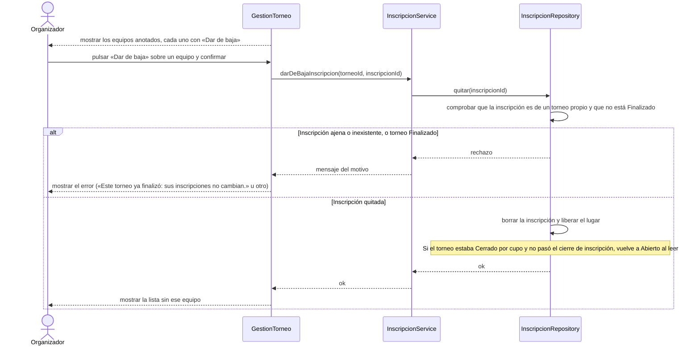

# S07 · UC-E07 — Dar de baja una inscripción

Caso de uso: [UC-E07](../02-casos-de-uso.md#uc-e07--dar-de-baja-una-inscripción) · Pantalla: [P3](../03-pantallas.md#p3--gestión-del-torneo) (pestaña Inscripciones) · Requerimientos: RF-E28, RF-E31

No hay desplegables. Es un botón en cada equipo anotado, que es un formulario con los ids en campos ocultos (funciona sin JavaScript).

## Cómo se lee

- **Libera el lugar:** el equipo deja de figurar en el torneo (y en su ficha pública) y el cupo vuelve a tener un lugar. Si el torneo estaba **Cerrado por cupo** y todavía no pasó el cierre de inscripción, **vuelve a Abierto**: el Estado se calcula al leer.
- **Un torneo Finalizado no cambia sus inscripciones.** Aunque el botón no se ofrezca, el torneo puede terminar entre que se cargó la página y se pulsó: la base lo vuelve a comprobar.
- **Los ids vienen del cliente y no son de confiar:** que la inscripción sea de un torneo del organizador lo decide la función de la base.
- **No avisa a nadie.** Dar de baja una inscripción no genera Avisos: solo la baja del torneo avisa a los planteles.

## Correspondencia en el código

`removeInscription` (`src/app/mis-torneos/[id]/inscripciones/actions.ts`) llama a la RPC `remove_inscription` y, si falla, vuelve a la pestaña con el código del error en la URL.
