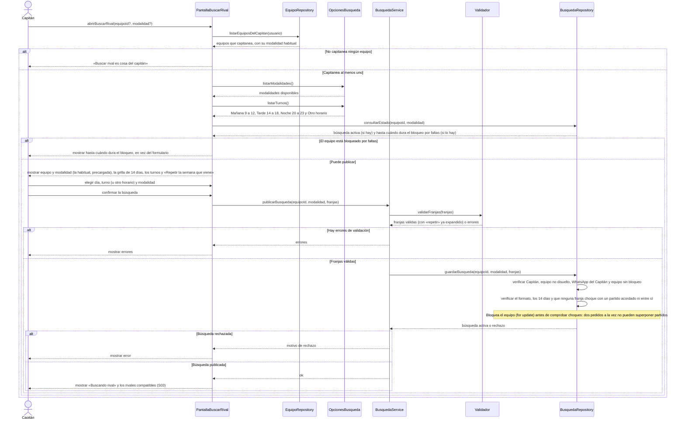

# S01 · UC-D01 — Publicar una búsqueda de rival

Caso de uso: [UC-D01](../02-casos-de-uso.md#uc-d01--publicar-una-búsqueda-de-rival) · Pantalla: [P2](../03-pantallas.md#p2--buscar-rival) · Requerimientos: RF-D02 a RF-D06, RF-D32

El formulario tiene **tres elecciones con opciones**: el **equipo** (si el Capitán capitanea más de uno), la **modalidad** y el **turno**. Siguiendo la guía de formularios, la pantalla obtiene las opciones **antes** de que el Capitán elija: los equipos, que se consultan en la base, de `EquipoRepository`; las modalidades y los turnos, que son listas fijas del código, de `OpcionesBusqueda`. Al enviar viajan solo los valores elegidos. La carga de las opciones y la publicación van en el mismo diagrama.

## Cómo se lee

- **Antes de elegir:** la pantalla obtiene los equipos de `EquipoRepository` y las modalidades y los turnos de `OpcionesBusqueda`. El equipo solo se pregunta si el Capitán capitanea más de uno; la modalidad llega con la habitual del equipo.
- **Al enviar,** `publicarBusqueda(...)` recibe solo los **valores elegidos** (`equipoId`, `modalidad`, `franjas`), no las listas. Las franjas se arman en el servidor a partir de fecha y horas enteras, en hora de Buenos Aires.
- **Se valida dos veces, y manda la base.** `Validador` revisa horas enteras, inicio menor que fin, dentro de 14 días, sin pisarse y el atajo «repetir»; la función de la base **repite todo** (formato, 14 días, 8 a 24, al menos 1 h, hoy en una hora que no pasó, choques) y además verifica Capitán, WhatsApp y bloqueo.
- **Una franja que choca con un partido acordado se rechaza**; entre búsquedas de **distinta modalidad** del mismo equipo se pueden superponer.
- **La búsqueda guarda solo modalidad y franjas.** La cercanía y el nivel salen de la Zona y el nivel **actuales** del equipo, así que si el equipo los cambia, se refleja en el acto.
- **Publicar no genera ningún Aviso.** La búsqueda queda activa mientras le quede una franja por empezar y vence sola.
- **Suspensión (pendiente):** un Capitán suspendido no puede buscar rival; hoy no se verifica (UC-F05).
- **«Copiar horarios de la última búsqueda»** figura en las decisiones, pero no existe en el código (ver [«Sin decisión»](../01-requerimientos.md#5-sin-decisión-y-diferencias-con-la-documentación)).

## Correspondencia en el código

`saveRivalSearch` (`src/app/partidos/actions.ts`): `parseRivalSearchForm` → RPC `save_rival_search(p_team_id, p_modality, p_slots)`. La pantalla es `app/partidos/buscar/page.tsx` con el componente `SlotPicker`.
