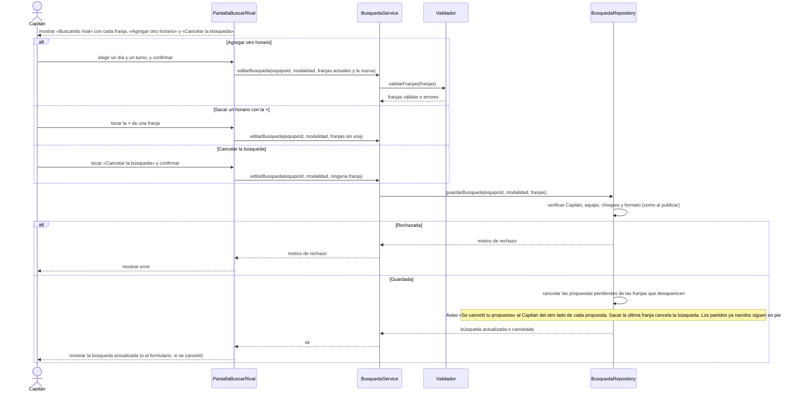

# S02 · UC-D02 — Editar o cancelar la búsqueda

Caso de uso: [UC-D02](../02-casos-de-uso.md#uc-d02--editar-o-cancelar-la-búsqueda) · Pantalla: [P2](../03-pantallas.md#p2--buscar-rival) · Requerimientos: RF-D07, RF-D08

Agregar un horario usa el mismo formulario de [S01](uc-d01-publicar-busqueda.md) (los mismos turnos y días). Este diagrama muestra lo que cambia: la función recibe **el conjunto completo de franjas** que debe quedar, y las que desaparecen **cancelan sus propuestas**.

## Cómo se lee

- **Una sola función para las tres cosas.** `save_rival_search` recibe el **conjunto completo de franjas**: agregar es mandar una más, sacar es mandar una menos, y **cancelar es mandar ninguna**. La modalidad no se cambia: es otra búsqueda.
- **Las propuestas siguen a las franjas.** Sacar una franja cancela sus propuestas pendientes (enviadas y recibidas), con el Aviso «Se canceló tu propuesta» al Capitán del otro lado. Cancelar la búsqueda cancela todas.
- **Los partidos que ya nacieron de la búsqueda siguen en pie.** Que nazca un partido no cierra la búsqueda: sigue con sus otras franjas.
- **La validación se repite en la base**, igual que al publicar.

## Correspondencia en el código

Misma Server Action que S01, `saveRivalSearch`; la base distingue crear, editar y cancelar según el conjunto de franjas que recibe.
