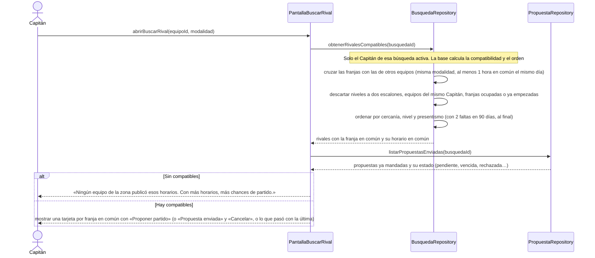

# S03 · UC-D03 — Ver rivales compatibles

Caso de uso: [UC-D03](../02-casos-de-uso.md#uc-d03--ver-rivales-compatibles) · Pantalla: [P2](../03-pantallas.md#p2--buscar-rival) · Requerimientos: RF-D09, RF-D10, RF-D31

Es una consulta: no hay formulario ni desplegables.

## Cómo se lee

- **La calcula la base, no la pantalla:** `compatible_rivals` es una función `security definer` que responde solo al Capitán de esa búsqueda activa y devuelve el equipo, la franja y el horario en común, **ya ordenados**.
- **Compatible significa:** misma modalidad y al menos 1 h en común el mismo día; los niveles con dos escalones de diferencia (recreativo contra competitivo) **no se cruzan**; **nunca dos equipos del mismo Capitán** (si no, una persona cargaría los dos resultados y las dos calificaciones); una **franja ocupada** (superpuesta con un partido del equipo) o ya empezada se ignora.
- **Orden:** primero la cercanía (Zona, luego Corredor, luego Región), después el nivel y por último el **presentismo** (faltas en los últimos 90 días, de menos a más; sin historial cuenta 0). Los equipos con **2 faltas en 90 días** van al final igual. Empate: el horario en común más temprano primero.
- **La Zona y el nivel son los actuales del equipo:** la búsqueda no los guarda.
- **Cada tarjeta recuerda lo ya hecho:** si ya se le mandó una propuesta por ese par de franjas, se ve «Propuesta enviada»; si la última se cerró, una nota dice qué pasó y se puede volver a proponer.

## Correspondencia en el código

`app/partidos/buscar/page.tsx` llama a la función `compatible_rivals(p_search_id)` y lee `proposals` de la búsqueda. Probado en `supabase/tests/compatible_rivals_test.sql`.
