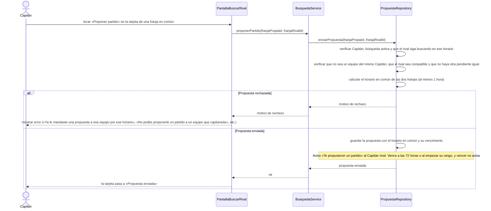

# S04 · UC-D04 — Proponer un partido

Caso de uso: [UC-D04](../02-casos-de-uso.md#uc-d04--proponer-un-partido) · Pantalla: [P2](../03-pantallas.md#p2--buscar-rival) · Requerimientos: RF-D11, RF-D12

No hay formulario ni desplegables: el Capitán toca «Proponer partido» sobre una tarjeta de [S03](uc-d03-ver-rivales-compatibles.md). La propuesta **no lleva mensaje** y **nadie elige un rango**.

## Cómo se lee

- **Qué viaja:** solo los ids de las dos franjas. **El horario lo calcula la app**: es la parte compartida de las dos franjas; nadie elige un rango y no hay mensaje.
- **La base repite todas las reglas** (los ids vienen del cliente y no son de confiar): el Capitán, que la búsqueda siga activa, que el rival siga buscando en ese horario, que no sean equipos del mismo Capitán, que haya al menos 1 h en común, que sea compatible y que no haya una pendiente igual.
- **Sin límite** de propuestas pendientes por equipo; solo no se puede mandar otra al mismo rival por el mismo horario mientras la anterior esté pendiente.
- **Vence sola** a las 72 h o cuando empieza su rango (lo que ocurra primero) y **no avisa**: el estado se calcula al leer.
- **Una propuesta cerrada no impide volver a proponer.**

## Correspondencia en el código

`sendProposal` (`src/app/partidos/actions.ts`) llama a la RPC `send_proposal(p_slot_id, p_rival_slot_id)`. Probado en `supabase/tests/proposals_test.sql`.
