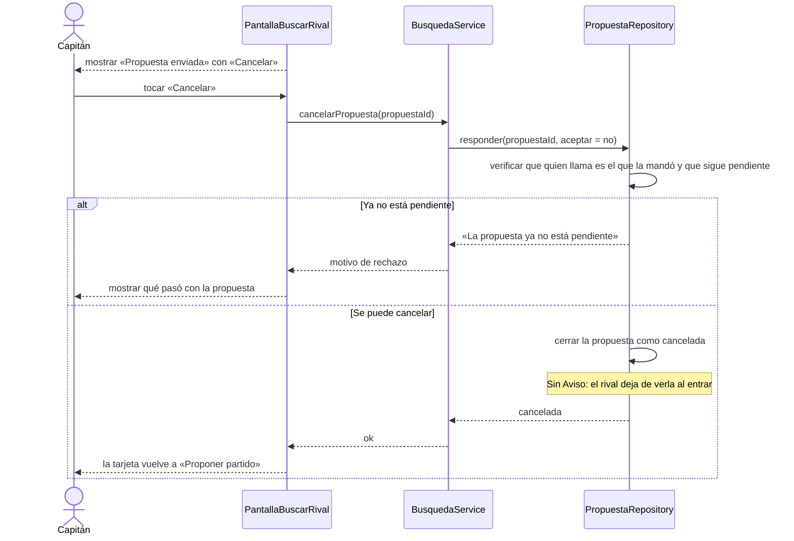

# S05 · UC-D05 — Cancelar una propuesta enviada

Caso de uso: [UC-D05](../02-casos-de-uso.md#uc-d05--cancelar-una-propuesta-enviada) · Pantalla: [P2](../03-pantallas.md#p2--buscar-rival) · Requerimientos: RF-D13

No hay formulario ni desplegables.

## Cómo se lee

- **Cancelar no avisa.** Solo avisan las cancelaciones en cascada (sacar una franja, cancelar la búsqueda, disolver el equipo, el bloqueo por faltas). El rival simplemente deja de ver la propuesta al entrar a Partidos: **esa pantalla es la fuente de verdad**.
- **Se puede volver a proponer** el mismo horario.
- **Es la misma función que rechazar** (`respond_proposal`): el sistema distingue qué hace por **quién la llama**. El receptor que dice «no» rechaza (con Aviso); el emisor que dice «no» cancela (sin Aviso).

## Correspondencia en el código

`declineProposal` (`src/app/partidos/actions.ts`) llama a `respond_proposal(p_proposal_id, p_accept = false)`.
