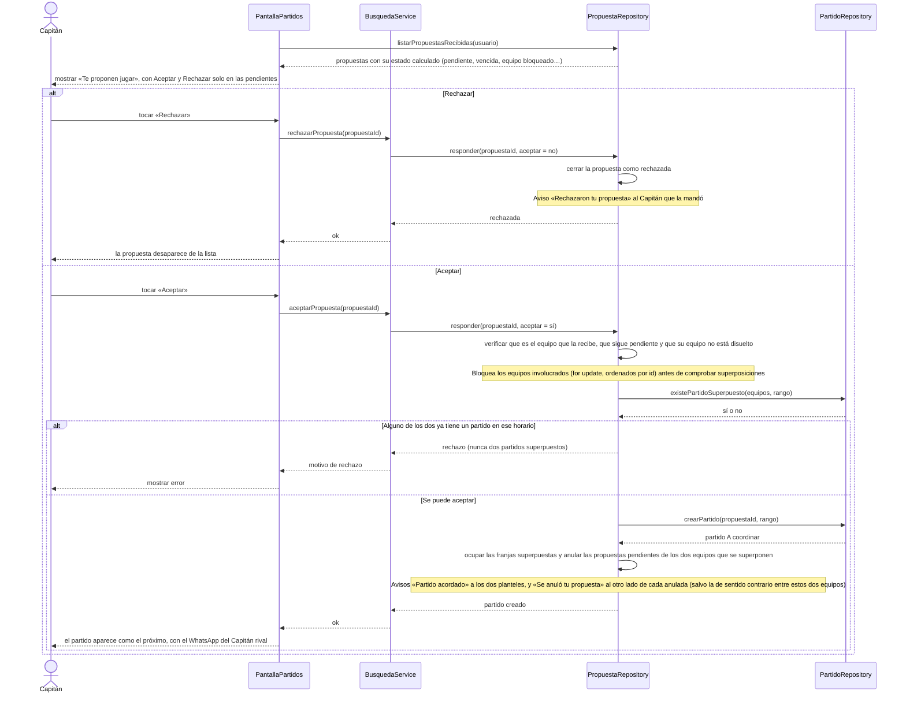

# S06 · UC-D06 — Aceptar o rechazar una propuesta

Caso de uso: [UC-D06](../02-casos-de-uso.md#uc-d06--aceptar-o-rechazar-una-propuesta) · Pantalla: [P1](../03-pantallas.md#p1--partidos) («Te proponen jugar») · Requerimientos: RF-D14 a RF-D18

No hay formulario ni desplegables: son dos botones (**Aceptar** y **Rechazar**) sobre cada propuesta recibida.

## Cómo se lee

- **Qué nace al aceptar:** un **Partido** con el rango de la propuesta, en estado **A coordinar**. Las horas que ocupa son siempre ese rango. Cada Capitán ve el **WhatsApp del otro** (siempre el del Capitán actual) mientras el partido esté por jugarse.
- **Nunca dos partidos superpuestos.** Al aceptar, la base bloquea las filas de los equipos involucrados y comprueba si alguno ya tiene un partido en ese horario; si lo tiene, la aceptación se rechaza. Al nacer el partido, además, las franjas que se superponen quedan **ocupadas** (salen de los compatibles) y se **anulan** las propuestas pendientes que se superponen.
- **Equipo bloqueado por faltas:** la propuesta se ve cancelada, sin botones, con la nota «el equipo está bloqueado por faltas», hasta cuando vencería. Es la única forma de que el rival se entere: el bloqueo no avisa.
- **El rechazo sí avisa** («Rechazaron tu propuesta»); cancelar la propia no ([S05](uc-d05-cancelar-propuesta.md)).
- **Las propuestas vencidas** (72 h o rango empezado) se calculan al leer y no avisan.

## Correspondencia en el código

`acceptProposal` y `declineProposal` (`src/app/partidos/actions.ts`) llaman a `respond_proposal(p_proposal_id, p_accept)`. Probado en `proposals_test.sql` y `matches_test.sql`.
