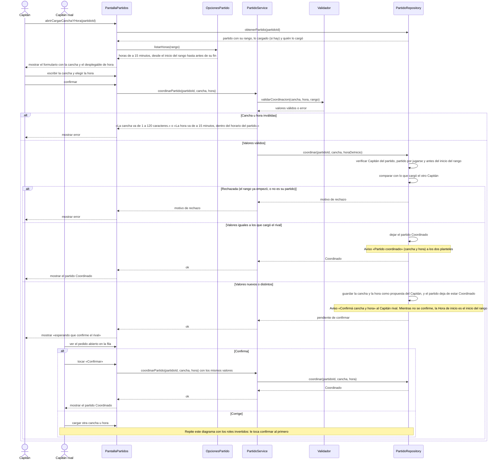

# S07 · UC-D07 — Coordinar cancha y hora

Caso de uso: [UC-D07](../02-casos-de-uso.md#uc-d07--coordinar-cancha-y-hora) · Pantalla: [P1](../03-pantallas.md#p1--partidos) (el próximo partido y las filas) · Requerimientos: RF-D19, RF-D20

El formulario tiene **un desplegable: la hora** (de a 15 minutos) y un campo de texto, la **cancha**. Siguiendo la guía de formularios, la pantalla obtiene las opciones **antes** de que el Capitán elija. La hora **no sale de la base ni de una lista fija**: la calcula la app a partir del rango del partido (`OpcionesPartido`). Al enviar viajan solo los valores elegidos. La carga y la coordinación van en el mismo diagrama. Los Capitanes arreglan **por WhatsApp**; la app solo registra lo acordado.

## Cómo se lee

- **Antes de elegir:** la pantalla trae el partido y calcula las horas posibles con `OpcionesPartido`. En un partido de **20 a 22**, las horas son de 20:00 a 21:45 (desde el inicio del rango incluido hasta el fin excluido).
- **Al enviar,** `coordinarPartido(...)` recibe solo la **cancha** y la **hora** elegidas. La cancha es texto libre (de 1 a 120 caracteres) y se muestra con «Ver en el mapa».
- **Cargar, confirmar y corregir son la misma operación.** Si el Capitán manda **los mismos valores** que cargó el otro, el partido queda **Coordinado**; si manda otros, es una corrección y le toca confirmar al primero.
- **Solo antes del inicio del rango.** Una vez que el rango empezó, no se carga, confirma ni corrige, **aunque la hora coordinada sea más tarde**: si no, corregir a las 20:30 un partido de 20 a 22 coordinado a las 21 lo des-coordinaría cuando ya habría empezado.
- **Cambiar después de Coordinado** es posible hasta el inicio del rango: el partido deja de estar Coordinado, le toca confirmar al otro y la Hora de inicio vuelve a ser el inicio del rango. Los «Vamos» ya dados no se borran. **Para cambiar de día,** se tira el partido y se propone de nuevo.
- **Coordinar es una ayuda, no un requisito:** un partido que llega a su hora sin coordinar sigue el flujo normal.

## Correspondencia en el código

`coordinateMatch` (`src/app/partidos/actions.ts`): `parseCoordination` → RPC `coordinate_match(p_match_id, p_venue, p_start_at)`. Las horas salen de `coordinationTimes` (`src/utils/match-forms.ts`). Probado en `match_coordination_test.sql`.
