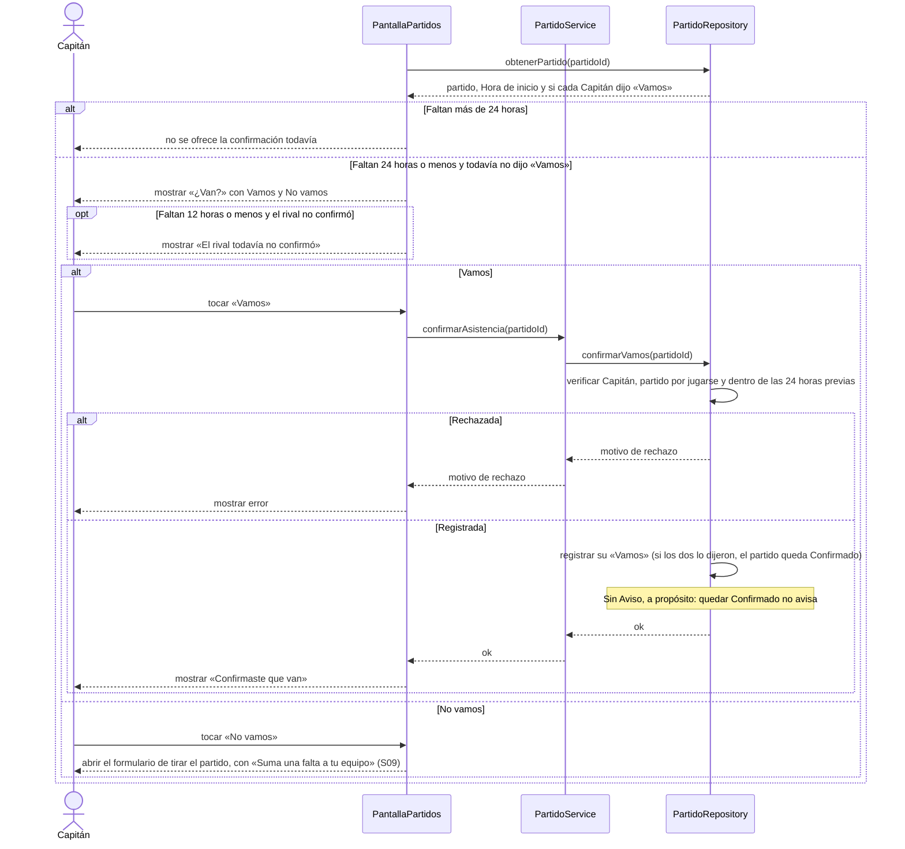

# S08 · UC-D08 — Confirmar asistencia

Caso de uso: [UC-D08](../02-casos-de-uso.md#uc-d08--confirmar-asistencia) · Pantalla: [P1](../03-pantallas.md#p1--partidos) («¿Van?») · Requerimientos: RF-D21

No hay formulario ni desplegables: son dos botones, **Vamos** y **No vamos**.

## Cómo se lee

- **La ventana empieza 24 h antes de la Hora de inicio.** Antes, no se ofrece. Después, al entrar, cada Capitán que todavía no confirmó ve «¿Van?».
- **Confirmado no es una fase:** es un dato del partido por jugarse. Se alcanza cuando los dos dijeron «Vamos», y **no genera ningún Aviso**, a propósito.
- **Desde 12 h antes**, si el rival todavía no confirmó, la pantalla lo dice («El rival todavía no confirmó»); tampoco avisa: se ve al entrar.
- **Si nadie confirma, no pasa nada:** el partido sigue en pie. Confirmar es una ayuda, no un requisito.
- **«No vamos» no es otra función:** abre el formulario de tirar el partido ([S09](uc-d09-tirar-partido.md)), que con menos de 24 h suma una falta. Por eso el formulario lo advierte.
- **La Hora de inicio** es la hora exacta coordinada o, si no se coordinó, el inicio del rango.

## Correspondencia en el código

`confirmGoing` (`src/app/partidos/actions.ts`) llama a la RPC `confirm_going(p_match_id)`. Probado en `match_coordination_test.sql`.
