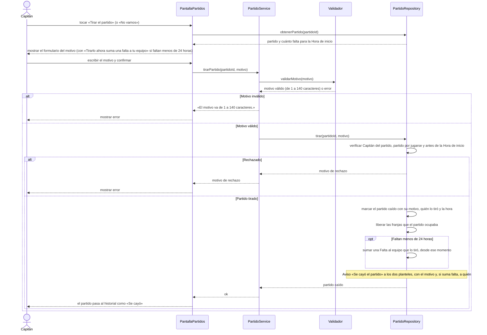

# S09 · UC-D09 — Tirar el partido

Caso de uso: [UC-D09](../02-casos-de-uso.md#uc-d09--tirar-el-partido) · Pantalla: [P1](../03-pantallas.md#p1--partidos) («Tirar el partido») · Requerimientos: RF-D22, RF-D31

El formulario tiene un único campo, el **motivo** (texto, sin desplegables). Si falta menos de 24 h, el formulario **advierte que suma una falta**.

## Cómo se lee

- **La falta la decide la fase, no el Capitán.** Con **menos de 24 h** para la Hora de inicio, tirar el partido suma una **Falta** al equipo que lo tiró, **desde el momento en que lo tiró**. Con **24 h justas**, todavía no. Con más de 24 h, no.
- **El motivo es obligatorio** (1 a 140 caracteres) y queda **visible en el historial público**; nadie lo modera (riesgo aceptado el 27/10/2026). «Equipo suspendido» lo escribe el sistema en el mismo campo, para los partidos que cae una Suspensión.
- **Qué pasa al caer:** el partido entra al historial del equipo **desde que se tira**, aunque su fecha no haya llegado; las franjas que ocupaba se liberan; y los dos planteles reciben el Aviso.
- **Con menos de 24 h hay una salida sin falta:** pedir la **caída de común acuerdo** ([S10](uc-d10-caida-comun-acuerdo.md)).
- **Solo antes de la Hora de inicio.** Después, el partido solo admite resultado o «no vinieron».
- **Las faltas cuentan 90 días** para el presentismo, y 3 faltas bloquean al equipo 30 días. El bloqueo no avisa.

## Correspondencia en el código

`dropMatch` (`src/app/partidos/actions.ts`): `parseDropReason` → RPC `drop_match(p_match_id, p_reason)`. Las faltas salen de la vista `team_faults`. Probado en `match_drops_test.sql` y `team_faults_test.sql`.
