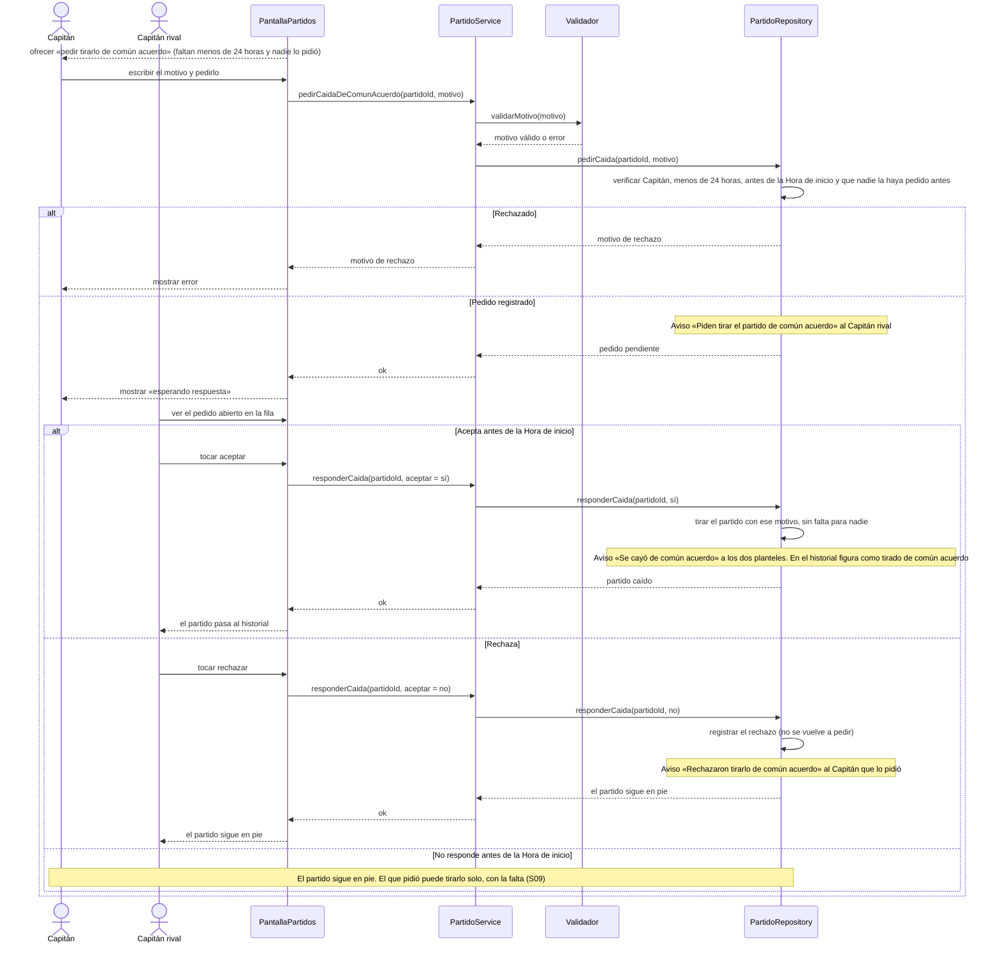

# S10 · UC-D10 — Caída de común acuerdo

Caso de uso: [UC-D10](../02-casos-de-uso.md#uc-d10--caída-de-común-acuerdo) · Pantalla: [P1](../03-pantallas.md#p1--partidos) · Requerimientos: RF-D23, RF-D35

El formulario es el del motivo ([S09](uc-d09-tirar-partido.md)); no hay desplegables. El caso tiene dos actores: el Capitán que **pide** y el Capitán rival que **responde**.

## Cómo se lee

- **Cuándo se ofrece:** solo con **menos de 24 h** para la Hora de inicio (con más, tirarlo no suma falta y no hace falta), antes de esa hora, y si **nadie pidió una antes** en este partido.
- **Si el rival acepta,** el partido se cae con ese motivo, **sin falta para nadie**, y queda en el historial como tirado de común acuerdo.
- **Si rechaza o no responde,** el partido sigue en pie y el que pidió todavía puede **tirarlo solo, con la falta** ([S09](uc-d09-tirar-partido.md)). **No se vuelve a pedir:** ninguno de los dos.
- **Un cambio de Capitán en el medio no lo traba:** el pedido es del equipo, y el Capitán nuevo responde el pedido pendiente (las búsquedas, propuestas y partidos son del equipo).
- **Los Avisos de este caso:** «Piden tirar el partido de común acuerdo» (al rival, pide acción), «Se cayó de común acuerdo» (a los dos planteles) y «Rechazaron tirarlo de común acuerdo» (al que pidió).

## Correspondencia en el código

`requestMutualDrop` y `answerMutualDrop` (`src/app/partidos/actions.ts`) llaman a `request_mutual_drop(p_match_id, p_reason)` y `answer_mutual_drop(p_match_id, p_accept)`. Probado en `match_drops_test.sql`.
