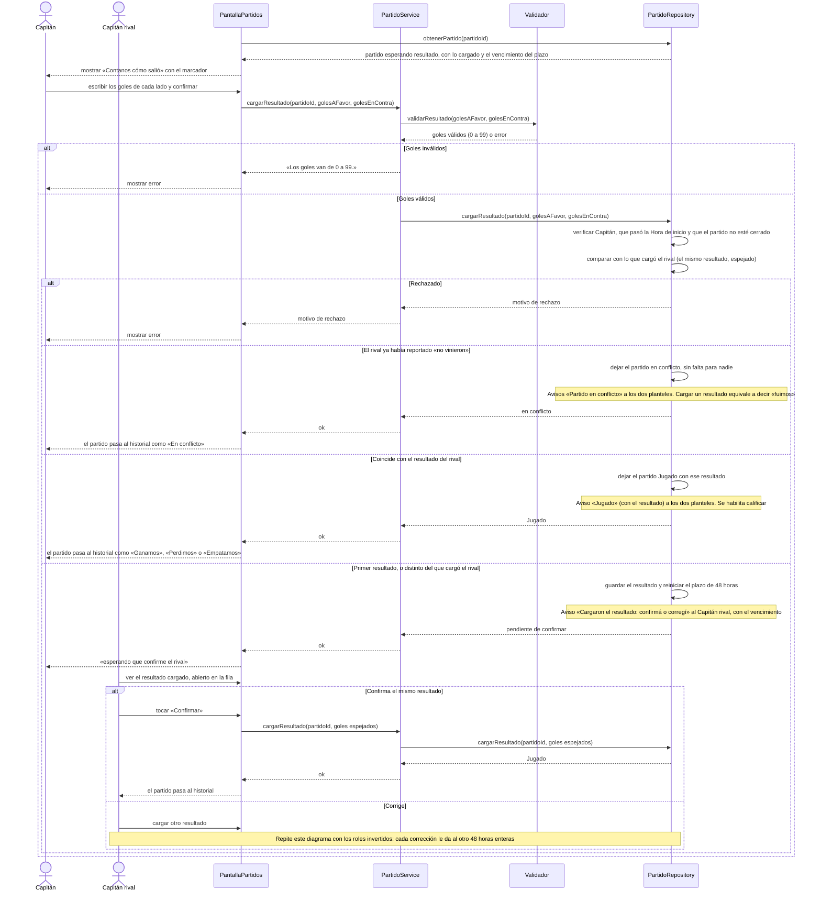

# S11 · UC-D11 — Cargar el resultado

Caso de uso: [UC-D11](../02-casos-de-uso.md#uc-d11--cargar-el-resultado) · Pantalla: [P1](../03-pantallas.md#p1--partidos) («Contanos cómo salió») · Requerimientos: RF-D24, RF-D25, RF-D27

El formulario es un **marcador** con dos goles (números de 0 a 99, el equipo propio a la izquierda): no hay desplegables. El caso tiene dos actores: quien **carga** y el Capitán rival, que **confirma o corrige**.

## Cómo se lee

- **Una sola función para cargar, confirmar y corregir.** Si los goles coinciden (espejados) con los que cargó el otro, el partido queda **Jugado**; si no, es una carga o una corrección y le toca al otro.
- **Los plazos de 48 h** se calculan **al leer**, contados desde la última carga de cualquiera de los dos (o, si nadie cargó, desde el fin del rango), y no avisan al vencer: si el rival no hace nada, el partido queda **Jugado con el resultado cargado**; con resultados distintos, cada corrección da 48 h enteras al otro, sin tope, y si siguen sin coincidir al vencer, **Jugado sin resultado**; si nadie carga, **Jugado sin resultado**, sin falta para nadie.
- **Cargar un resultado equivale a decir «fuimos».** Si el rival ya reportó «no vinieron» ([S12](uc-d12-reportar-no-se-presento.md)), el partido queda **en conflicto**. Quien cargó un resultado ya no puede reportar «no vinieron».
- **Un partido cerrado no se corrige más:** Jugado, en conflicto o con falta.
- **Solo después de la Hora de inicio.** Antes, el partido solo admite tirarlo.
- **Calificar** se habilita al quedar Jugado ([S13](uc-d13-calificar-rival.md)).

## Correspondencia en el código

`reportResult` (`src/app/partidos/actions.ts`): `parseResult` → RPC `report_result(p_match_id, p_goals_for, p_goals_against)`. El marcador es el componente `Scoreboard`. Probado en `match_results_test.sql`.
