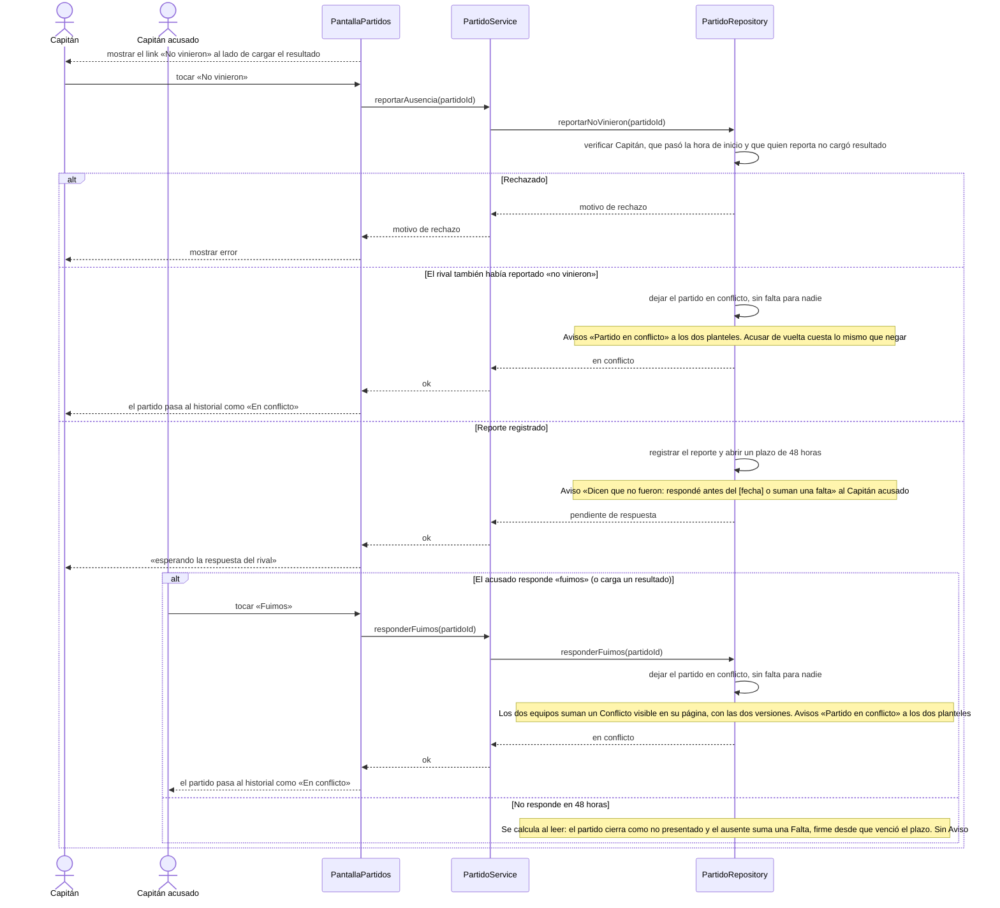

# S12 · UC-D12 — Reportar que el rival no se presentó

Caso de uso: [UC-D12](../02-casos-de-uso.md#uc-d12--reportar-que-el-rival-no-se-presentó) · Pantalla: [P1](../03-pantallas.md#p1--partidos) («No vinieron») · Requerimientos: RF-D26, RF-D27, RF-D31, RF-D33

No hay formulario ni desplegables: son botones. El caso tiene dos actores: el Capitán que **reporta** y el Capitán **acusado**, que responde. **Nadie arbitra.**

## Cómo se lee

- **Cuándo se puede:** una vez pasada la hora de inicio, y solo si quien reporta **no cargó un resultado** (cargarlo equivale a decir «fuimos»). Quien reportó ya no carga resultado: solo corrige.
- **El plazo de 48 h** lo calcula la base al leer; vencerlo **no avisa**. Si el acusado no responde, el partido cierra como **no presentado** y el ausente suma una **Falta** (cuenta 90 días para el presentismo).
- **Conflicto:** si el acusado responde «fuimos» (o carga un resultado), o si **los dos** reportan «no vinieron» (en la pantalla, «Ellos tampoco vinieron»), el partido queda **en conflicto**: **sin falta para nadie**. Los dos equipos suman un **Conflicto**, que se muestra en su página con las dos versiones, pero **nunca penaliza**. Un partido en conflicto no se califica.
- **Nadie arbitra.** El administrador no interviene en partidos ([ADR 0002](../../adr/0002-conflictos-sin-arbitro.md)): acusar de vuelta cuesta lo mismo que negar, y eso desalienta las acusaciones falsas.

## Correspondencia en el código

`reportNoShow` y `replyWent` (`src/app/partidos/actions.ts`) llaman a `report_no_show(p_match_id)` y `reply_went(p_match_id)`. Probado en `match_results_test.sql`.
