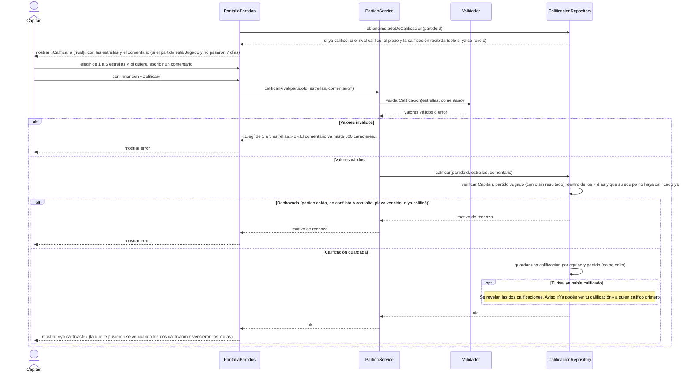

# S13 · UC-D13 — Calificar al rival

Caso de uso: [UC-D13](../02-casos-de-uso.md#uc-d13--calificar-al-rival) · Pantalla: [P1](../03-pantallas.md#p1--partidos) («Calificar a …») · Requerimientos: RF-D28, RF-D29

El formulario tiene **una elección entre cinco opciones** (de 1 a 5 estrellas) y un comentario de texto. Las estrellas son una **lista fija del código** (botones de opción), así que no hay repositorio que consultar. Al enviar viajan solo los valores elegidos.

## Cómo se lee

- **Cuándo se puede:** solo en un partido **Jugado** (con o sin resultado) y hasta **7 días** después de que quedó Jugado. Un partido caído, en conflicto o con falta **no se califica**. Un equipo **disuelto** se sigue calificando hasta que venzan los 7 días.
- **Una calificación por equipo y partido, y no se edita.** El Capitán califica al rival; 1 a 5 estrellas y un comentario opcional de hasta 500 caracteres.
- **El comentario es privado:** solo lo lee el administrador al revisar un equipo reportado; la tabla de calificaciones no se lee por la API.
- **Revelación cruzada, para que nadie califique en represalia.** Cada Capitán ve la calificación que le pusieron recién cuando **los dos calificaron** o **pasaron los 7 días**. Cuando la segunda calificación revela las dos, el que calificó primero recibe «Ya podés ver tu calificación»; revelar por vencimiento no avisa.
- **El promedio público** (las estrellas de la página del equipo) cuenta **solo las calificaciones reveladas**.

## Correspondencia en el código

`rateRival` (`src/app/partidos/actions.ts`): `parseRating` → RPC `rate_rival(p_match_id, p_stars, p_comment)`. Probado en `ratings_test.sql`.
