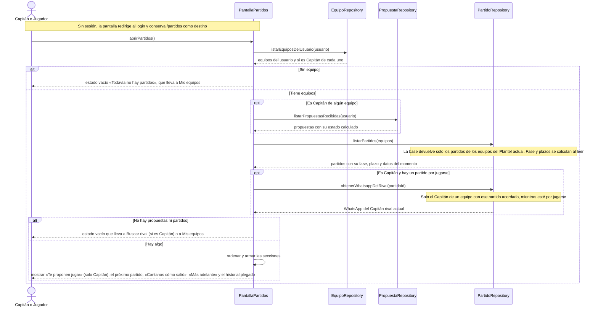

# S14 · UC-D14 — Ver mis partidos

Caso de uso: [UC-D14](../02-casos-de-uso.md#uc-d14--ver-mis-partidos) · Pantalla: [P1](../03-pantallas.md#p1--partidos) · Requerimientos: RF-D01, RF-D30

Es una consulta: no hay formulario ni desplegables. El actor es el Capitán o un Jugador del Plantel.

## Cómo se lee

- **Es la fuente de verdad:** todo lo pendiente se ve acá, **haya o no Aviso**. El Aviso es un puntero; esta pantalla tiene el estado actual.
- **El Jugador ve todo, sin botones.** Las propuestas las ve solo el Capitán. El **WhatsApp del Capitán rival** lo ve solo el Capitán, con un partido acordado y mientras esté por jugarse: lo entrega una función de la base que verifica eso.
- **Visibilidad por Plantel actual:** quien sale del Plantel deja de ver los partidos del equipo; el Capitán anterior, si queda en el Plantel, sigue viendo los partidos pero deja de ver las propuestas.
- **Muestra los partidos de todos los equipos del usuario juntos;** el nombre del equipo propio aparece solo si el usuario está en más de uno.
- **Cada fila muestra lo que pide respuesta abierto, con un solo botón primario;** lo que no pide nada, plegado detrás de un link.
- **El historial** (los cerrados: «Ganamos», «Perdimos», «Empatamos», «Se cayó», «En conflicto», «Falta») está plegado y va en primera persona. El detalle público (quién lo tiró, las dos versiones) vive en la página del equipo, **sin cancha ni hora**.
- **La fase y los plazos se calculan al leer** con la hora actual; no hay tareas programadas.

## Correspondencia en el código

`app/partidos/page.tsx` lee los partidos, las propuestas y los equipos, y arma las secciones con `utils/match-display.ts`; la fase la calcula la función `match_phase`. El WhatsApp sale de `rival_captain_whatsapp(p_match_id)`.
